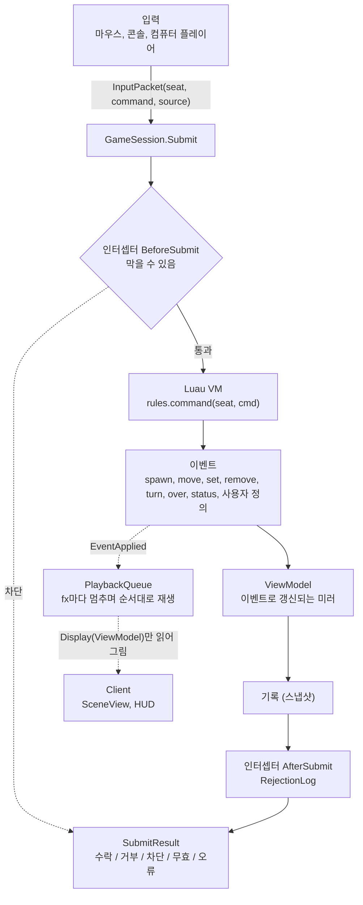
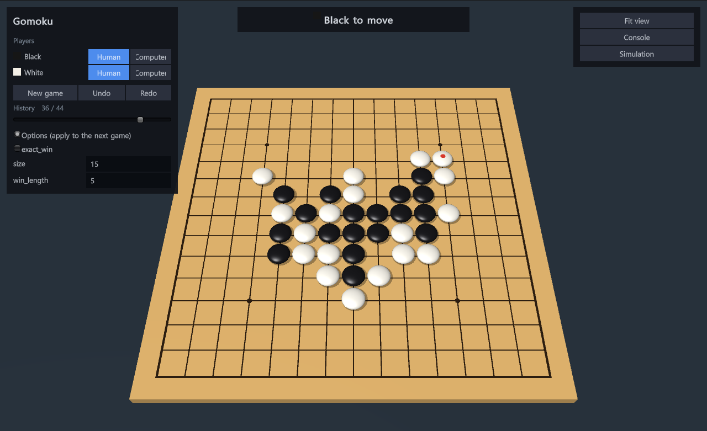
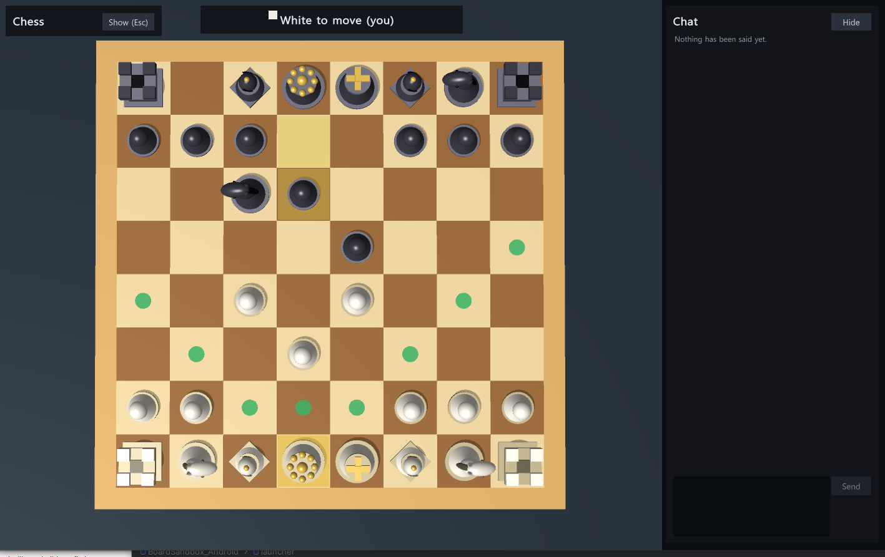
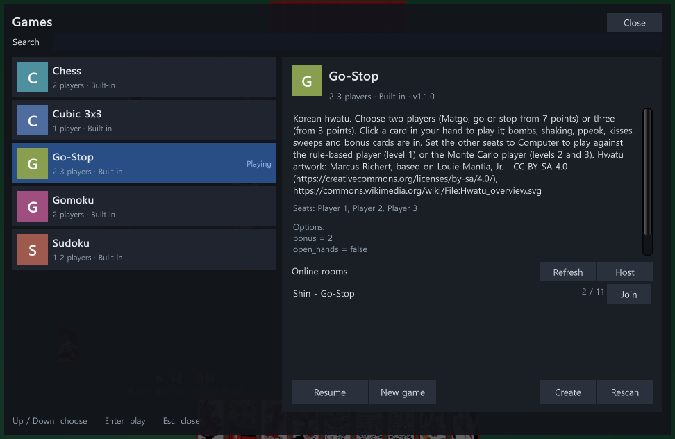
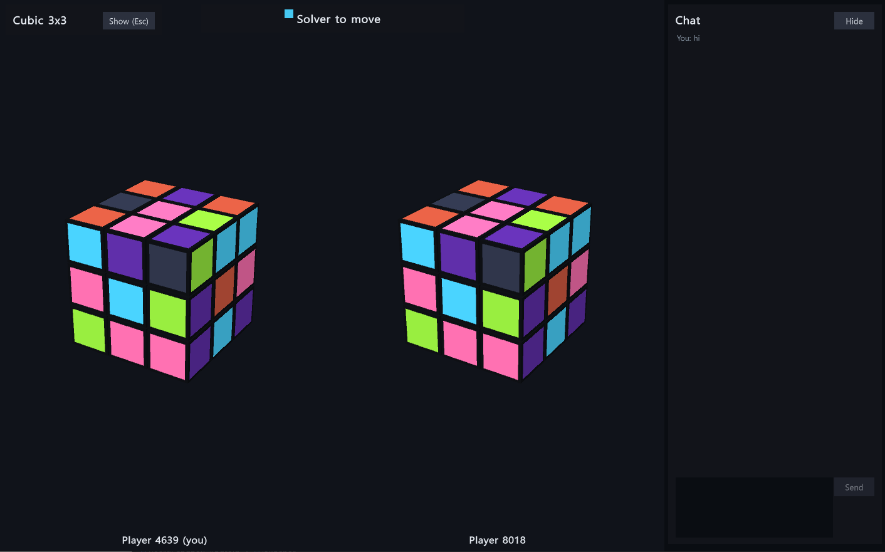
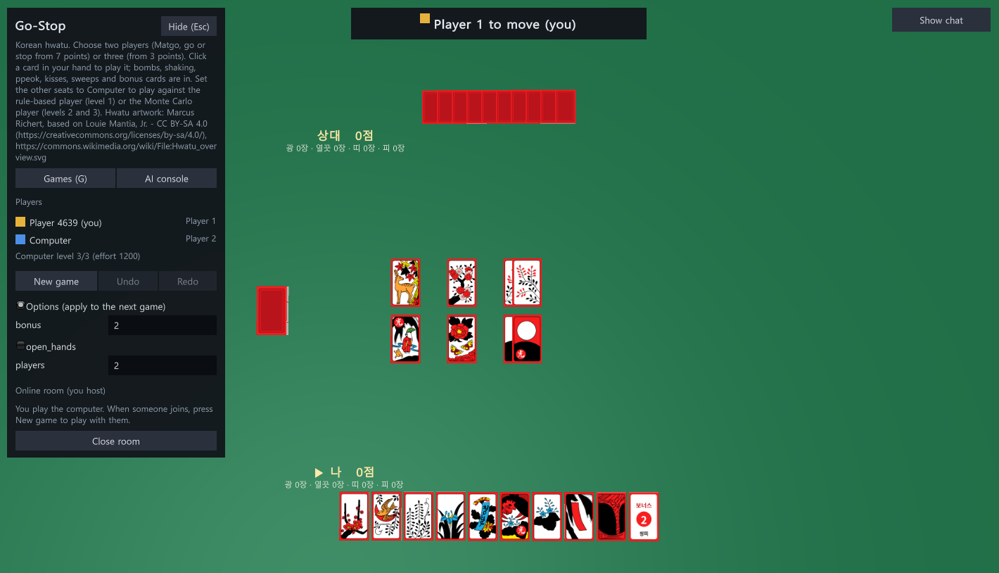
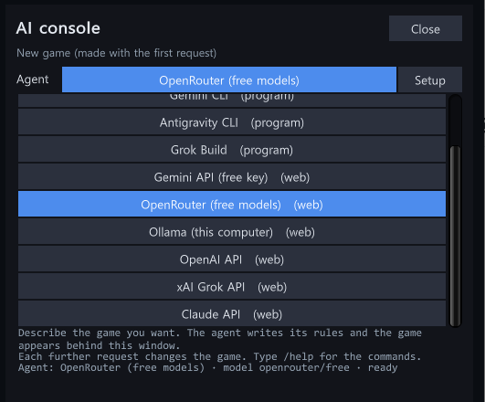
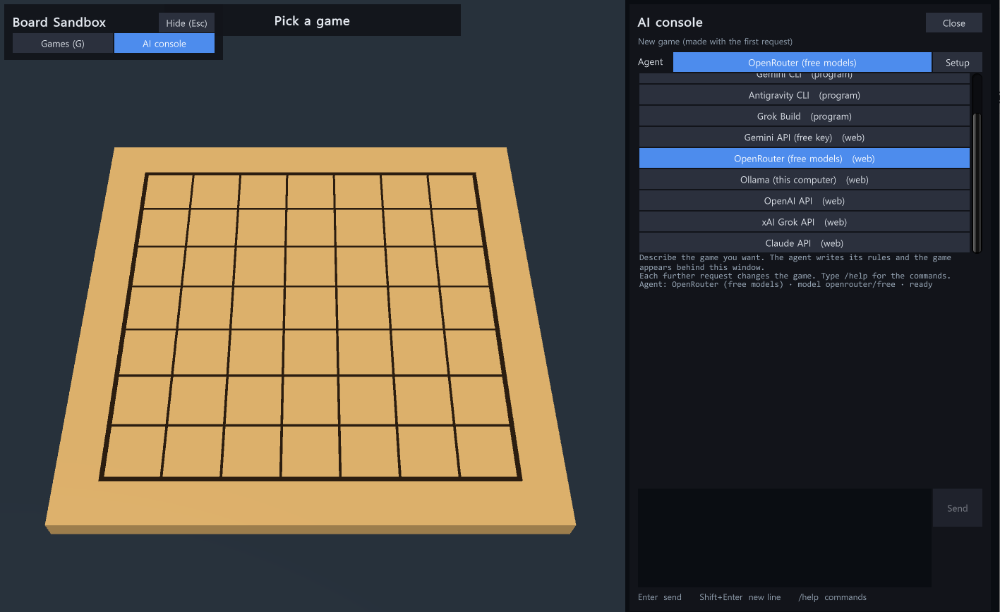
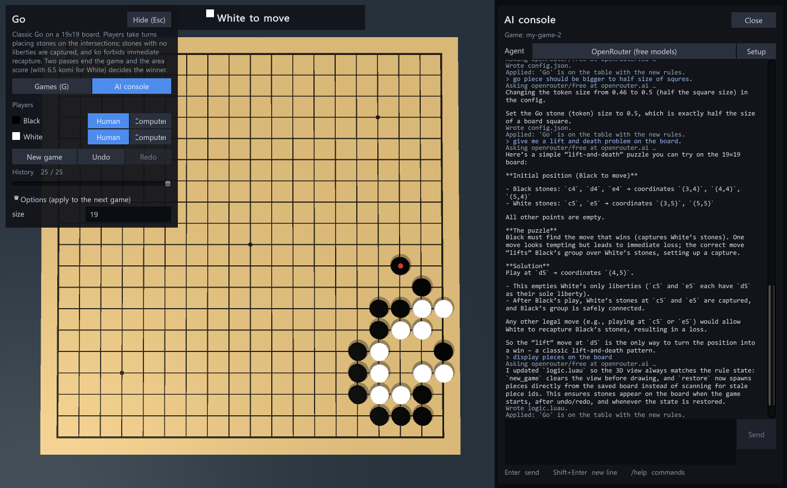

# Board Sandbox Engine

Unity 6.3 기반 보드게임 플랫폼(테이블탑 시뮬레이터 방식)입니다. 게임 규칙은 Luau 스크립트 모드로 작성하고, Unity(C#)는 규칙을 실행·검증하며 결과를 3D 장면으로 보여 줍니다. 기본으로 오목(Gomoku)과 3D 큐브 퍼즐(Cubic 3x3), 체스(Chess), 스도쿠(Sudoku), 고스톱(Go-Stop) 모드가 들어 있습니다.


## 목차

- [프로젝트 구조](#프로젝트-구조)
- [구조 개요](#구조-개요)
- [요구 사항](#요구-사항)
- [빠른 시작](#빠른-시작)
- [조작](#조작)
- [화면 구성](#화면-구성)
- [멀티플레이](#멀티플레이)
  - [Android 멀티플레이 설정](#android-멀티플레이-설정)
- [콘솔 명령](#콘솔-명령)
- [AI 콘솔](#ai-콘솔)
  - [에이전트](#에이전트)
  - [AI 콘솔 명령](#ai-콘솔-명령)
  - [에이전트 설정 파일](#에이전트-설정-파일)
- [모드](#모드)
  - [시작 규칙](#시작-규칙)
  - [config.json](#configjson)
  - [컴퓨터 플레이어](#컴퓨터-플레이어)
  - [규칙 스크립트](#규칙-스크립트)
  - [bse API](#bse-api)
  - [최소 예제](#최소-예제)
  - [클라이언트 힌트](#클라이언트-힌트)
  - [정적 분석](#정적-분석)
- [C#에서 사용하기](#c에서-사용하기)
- [네이티브 라이브러리 빌드](#네이티브-라이브러리-빌드)
- [테스트](#테스트)
  - [빌드](#빌드)
- [상태와 제한](#상태와-제한)
- [라이선스](#라이선스)

## 프로젝트 구조

```
Assets/
├─ BoardSandbox/
│  ├─ Runtime/Core/      Unity 비의존 C# (asmdef noEngineReferences): Luau, 모드, 세션, 호스트, Net(방과 프로토콜, 작은 패킷으로 나눠 보내는 전송), Agents(AI 콘솔), Ai(모드의 Luau 컴퓨터 플레이어를 부르는 부분과 단계 기록)
│  ├─ Runtime/Client/    Unity 표현 계층: 앱, 카메라, 장면 뷰, IMGUI HUD와 게임 선택 화면, 셰이더, Steam 연동(Windows), Epic Online Services 연동(Android)
│  ├─ Editor/            메뉴, 네이티브 플러그인 설정, Android 빌드 전 검사, 만들어진 Gradle 프로젝트의 EOS 라이브러리 보정
│  ├─ Plugins/Windows/x86_64/   bse_luau.dll
│  ├─ Plugins/Android/<ABI>/    libbse_luau.so (arm64-v8a, armeabi-v7a, x86_64)
│  └─ Tests/Editor/      NUnit 테스트 (EditMode)
└─ StreamingAssets/Mods/
   ├─ gomoku/            오목 (logic.luau 규칙, ai.luau 컴퓨터 플레이어)
   ├─ chess/             체스 (logic.luau, chess.luau 규칙, pieces.luau 기물 모양, ai.luau 컴퓨터 플레이어)
   ├─ cubic3/            3D 큐브 퍼즐
   ├─ gostop/            고스톱 (2인 맞고·3인, gostop.luau 규칙, ai.luau 컴퓨터 플레이어, cards.png 화투 도안)
   └─ sudoku/            스도쿠 (1인, 또는 방에서 2인 협동, 컴퓨터 대신 힌트 3개)
Native/
├─ bse_luau/             C ABI 래퍼(C++17), CMake, Luau 프렐류드, 네이티브 테스트, 분석 도구
└─ scripts/              build_native.py (Windows DLL과 Android .so 빌드), check_android_lib.py (.so 검사)
Tools/
├─ CoreTests/            Unity 없이 테스트를 실행하는 dotnet 하네스
├─ Hwatu/                make_atlas.py: 화투 도안(SVG)에서 고스톱의 cards.png를 만드는 스크립트
├─ FixEosAndroidExport.ps1  이미 내보낸 Android 프로젝트의 EOS 라이브러리와 launcher 설정을 Unity 없이 고치는 PowerShell 스크립트
└─ UnityCheck/           Unity API 대비 컴파일 검사용 프로젝트
.github/workflows/       android-native.yml: NDK로 Android 라이브러리를 빌드해 커밋
Image/                   README의 화면 그림
steam_appid.txt          Steam 앱 ID (테스트용 480)
LICENSE.md
THIRD_PARTY_NOTICES.txt
```

## 구조 개요



- **bse_luau** (네이티브): Luau VM을 C ABI(버전 1)로 감쌉니다. 모든 호출은 JSON 문자열 입출력(`bse_vm_call`)이고 메모리·시간 한도와 로그 수집을 제공합니다. 내보내는 함수는 `bse_*` 10개이며 헤더는 `Native/bse_luau/include/bse_luau.h`입니다.
- **BoardSandbox.Core**: `LuauVm`(P/Invoke), 모드 로더, 모드 출처와 카탈로그(`IModSource`, `ModCatalog`), `GameSession`(검증, 이벤트 미러, 스냅샷 기록, 오류 복구), `PlaybackQueue`, `CommandConsole`, `SimulationRunner`, `GameHost`, `GameLibrary`, `Net`(`Multiplayer`, `NetHostRoom`, `NetClientRoom`, 작은 패킷만 보낼 수 있는 연결 위에서 방 메시지를 나눠 보내고 다시 합치는 `PacketTransport`).
- **BoardSandbox.Client**: `BoardSandboxApp` 하나가 일반 C# 클래스(장면 뷰, 카메라, HUD, 게임 선택 화면, Windows의 Steam 연동, Android의 EOS 연동)를 구동하는 구성 루트입니다. 화면에 보이는 판마다 `SceneView`, 카메라, `PlaybackQueue`를 하나씩 두며, 분할 화면에서는 판마다 레이어(31번부터 아래로)와 카메라 뷰포트를 나눕니다.

멀티플레이에서는 호스트의 `NetHostRoom`이 세션의 이벤트를 참가자에게 보내고, 참가자의 `NetClientRoom`이 받은 이벤트를 자기 `PlaybackQueue`에 넣습니다. 참가자의 입력은 호스트에서 좌석과 차례를 확인한 뒤(차례가 없는 협동 게임은 좌석만 확인합니다) `GameSession.Submit`으로 들어갑니다. 메시지는 JSON이며 `hello`, `welcome`, `roster`, `sync`, `ev`, `cmd`, `note`, `finished`, `bye`가 있습니다.

- **모드로 게임 추가**: `config.json`과 `.luau` 파일이 든 폴더 하나가 게임 하나입니다. 규칙, 화면, 입력, 컴퓨터 플레이어까지 게임에 관한 것은 모두 그 폴더의 Luau와 JSON에 있고, C# 쪽에는 특정 게임을 아는 코드가 없습니다.
- **게임 선택 화면**: 앱에 들어 있는 게임과 로컬 폴더의 게임을 한 목록에서 검색하고 고릅니다. 모드는 출처(`Built-in`, `Local`, `Workshop`)를 갖고, 출처별로 모드를 읽어 오는 부분은 `IModSource`로 분리돼 있습니다.
- **장면도 모드가 정함**: 보드, 테이블, 배경, 조명, 카메라, 표시(마커), 말의 모양·크기·위치·회전·면 색을 `config.json`과 Luau에서 정합니다. 클릭, 드래그, 키 입력도 모드가 명령으로 받습니다.
- **멀티플레이**: Windows는 Steam, Android는 Epic Online Services(EOS)로 이어지고 두 방식은 서로 연결되지 않습니다. 게임을 고르면 그 게임을 하는 방 목록이 나오고, 방을 열거나 들어갑니다. 한 판을 함께 두는 게임은 한 화면을 동기화하고, 각자 푸는 게임은 화면을 나눠 서로의 판을 봅니다.
- **호스트 권한**: 마우스, 콘솔, 컴퓨터 플레이어의 모든 입력은 `GameSession.Submit` 하나를 거쳐 규칙 스크립트(`rules.command`)의 검증을 통과해야 반영됩니다. 거부된 입력은 코드와 사유가 붙은 결과로 돌아옵니다.
- **인터셉터**: `ICommandInterceptor`로 입력이 규칙에 닿기 전에 막거나(`TurnGuard`), 처리 뒤 결과를 기록할 수 있습니다(`RejectionLog`).
- **시간 되감기**: 수마다 스냅샷을 남겨(최대 4096단계) 되돌리기, 다시 실행, 임의 지점 이동을 지원합니다. 모드가 `snapshot`과 `restore`를 제공해야 합니다.
- **헤드리스 시뮬레이션**: 화면 없이 별도 VM에서 무작위 대국을 대량으로 돌려 승패, 무승부, 평균 수를 집계합니다. 같은 모드, 옵션, 시드이면 결과가 같습니다.
- **콘솔**: 텍스트 명령으로 게임을 진행하고 상태를 조회합니다. 스크립트 로그도 여기에 나옵니다.

## 요구 사항

| 항목 | 내용 |
|---|---|
| Unity | 6000.3 (6.3 LTS) |
| 플랫폼 | Windows 10 이상, x64 (에디터와 Standalone 빌드). Android 7.1(API 25) 이상은 IL2CPP로 빌드하며 ARM64, ARMv7, x86_64 라이브러리가 들어 있습니다([상태와 제한](#상태와-제한)) |
| 렌더 파이프라인 | Built-in, URP (셰이더에 `LightMode` 태그가 없어 둘 다에서 그려지도록 작성) |
| UI와 입력 | IMGUI(`OnGUI`). `UnityEngine.Input`, uGUI, UI Toolkit은 쓰지 않습니다 |
| 멀티플레이 (Windows) | Steam 클라이언트와 [Steamworks.NET](https://github.com/rlabrecque/Steamworks.NET) 2025.165.0 (`Packages/manifest.json`의 git 패키지, Unity가 받아 옵니다). 없어도 로컬 플레이는 됩니다 |
| 멀티플레이 (Android) | [Epic Online Services](https://dev.epicgames.com/docs)(EOS) 제품과 [EOS Plugin for Unity](https://github.com/EOS-Contrib/eos_plugin_for_unity_upm) 6.2.0 (`Packages/manifest.json`의 git 패키지, Unity가 받아 옵니다. 받는 컴퓨터에 git과 git-lfs가 있어야 합니다). 제품 정보는 저장소에 없고 직접 넣어야 합니다([Android 멀티플레이 설정](#android-멀티플레이-설정)). 설정이 없어도 로컬 플레이는 됩니다 |

네이티브 라이브러리 `bse_luau.dll`(Luau 0.745를 정적으로 포함, 외부 의존은 KERNEL32와 Windows UCRT뿐)은 `Assets/BoardSandbox/Plugins/Windows/x86_64/`에 들어 있어 따로 설치할 것이 없습니다. 직접 빌드하려면 [네이티브 라이브러리 빌드](#네이티브-라이브러리-빌드)를 보세요.

Android용 `libbse_luau.so`(Luau 0.745와 NDK의 libc++를 정적으로 포함, 외부 의존은 모든 기기에 있는 libc, libm, libdl뿐)는 ABI별로 `Assets/BoardSandbox/Plugins/Android/<ABI>/`에 들어 있습니다. 이 라이브러리가 빠진 Android 빌드는 만들어지고 설치되고 시작도 하지만 게임을 하나도 불러오지 못하고 `Unable to load DLL 'bse_luau'` 오류가 납니다. 그래서 Android 빌드를 시작하기 전에 선택한 CPU(Player Settings의 Target Architectures)마다 라이브러리가 있는지 검사하고, 없으면 빌드를 중단하고 이유를 알려 줍니다(`NativePluginBuildCheck`).

Android에서는 `StreamingAssets`가 APK(zip 파일) 안에 들어가 폴더로 열 수 없습니다(`Application.streamingAssetsPath`가 `jar:file://…/base.apk!/assets`). 그래서 앱에 들어 있는 게임은 APK를 zip으로 열어 `assets/Mods`에서 직접 읽습니다([모드](#모드)). 이 읽기가 없던 빌드는 게임 목록이 비어 `No games found`가 나왔습니다.

## 빠른 시작

1. Unity Hub에서 **Add > Add project from disk**로 이 폴더를 열고 6000.3.x 에디터를 선택합니다.
2. 메뉴 **Board Sandbox > Check Native Plugin**을 실행해 Luau 버전이 표시되는지 확인합니다.
3. 아무 씬에서 **Play**를 누르면 `BoardSandboxApp`이 자동으로 만들어집니다. 기본 설정에서는 Cubic 3x3이 판에 올라가고 그 위에 게임 선택 화면이 열립니다. Initial Mod를 비우면 읽은 게임이 하나뿐일 때만 그 게임이 올라가고, 둘 이상이면 판은 비어 있고 게임 선택 화면만 열립니다([시작 규칙](#시작-규칙)). 씬에 카메라가 없으면 `Board Camera`도 만듭니다.
4. 씬 파일이 필요하면 **Board Sandbox > Create Demo Scene**을 실행합니다.

| 에디터 메뉴 | 동작 |
|---|---|
| Board Sandbox/Check Native Plugin | 네이티브 라이브러리를 불러 Luau 버전을 보여 줍니다. 실패하면 사유를 보여 줍니다 |
| Board Sandbox/Create Demo Scene | 기본 카메라와 조명, `BoardSandboxApp`이 든 `Assets/BoardSandbox/Scenes/Board.unity`를 만들고 Build Settings의 씬 목록을 이 씬 하나로 설정합니다 |
| Board Sandbox/Fix Exported Android Project (EOS)... | 폴더를 골라(Unity가 Android 프로젝트를 내보낸 폴더) 그 안의 EOS 라이브러리 모듈 `eos_dependencies.androidlib`를 Gradle 9.1에 맞게 고치고 `launcher/build.gradle`에 core library desugaring 설정을 넣습니다. 내보낼 때 자동으로 하는 일과 같고, 이미 내보낸 폴더를 다시 내보내지 않고 고칠 때 씁니다. Unity 없이는 `Tools/FixEosAndroidExport.ps1`이 같은 일을 합니다([Android 멀티플레이 설정](#android-멀티플레이-설정)) |
| Board Sandbox/Fix Native Plugin Settings | `bse_luau.dll`(에디터와 Windows x64에서만 사용)과 `libbse_luau.so`(들어 있는 ABI 폴더의 CPU로 Android에서만 사용)의 플러그인 설정을 다시 적용합니다. 같은 설정을 에디터가 스크립트를 불러올 때마다 자동으로 확인합니다 |

자동 시작은 환경 변수 `BSE_AUTOSTART=0` 또는 스크립팅 정의 `BSE_NO_AUTOSTART`로 끕니다. 씬에 `BoardSandboxApp`이 이미 있으면 자동으로 만들지 않습니다.

`BoardSandboxApp`의 인스펙터 값:

| 필드 | 기본값 | 설명 |
|---|---|---|
| Initial Mod | `cubic3` | 시작할 게임의 id. 비어 있을 때와 찾지 못할 때의 동작은 [시작 규칙](#시작-규칙)을 보세요 |
| Extra Mod Folders | 비어 있음 | 모드를 찾을 추가 폴더 (출처 `Local`) |
| Start Game | 켜짐 | 시작할 게임이 정해졌으면 바로 새 게임을 엽니다. 끄면 게임만 고르고 `New game`을 기다립니다 |
| Open Game List | 켜짐 | 앱을 시작할 때 첫 게임 위로 게임 선택 화면을 엽니다. 끄면 게임이 바로 보입니다. 판에 올라온 게임이 없으면 이 값과 상관없이 엽니다 |
| Ui Scale | 0 | 0이면 화면 높이에 맞춰 자동 (1~2.5배, 0.25 단위) |

## 조작

| 입력 | 동작 |
|---|---|
| 왼쪽 클릭 | 모드가 `client.click.action`을 지정했고 둘 수 있는 차례일 때 명령을 제출합니다. 보드 게임은 클릭한 칸(`{ action, x, y }`), `click.target`이 `object`인 게임은 클릭한 오브젝트를 보냅니다 |
| 오른쪽 클릭 | `click.target`이 `object`인 게임에서 `button = 1`인 클릭 명령 |
| 오브젝트 위에서 왼쪽 드래그 | 모드가 `client.drag.action`을 지정했으면 끈 방향을 담은 명령 |
| 왼쪽 드래그, 가운데 버튼 드래그 | 카메라 이동 (모드가 `stage.camera`에서 바꿀 수 있음) |
| 오른쪽 드래그 | 카메라 회전 |
| 마우스 휠 | 확대/축소 |
| `F` | 장면 전체가 보이도록 카메라 맞춤 |
| `G` | 게임 선택 화면 열기 |
| `N` | 새 게임 |
| `Ctrl+Z`, `←` | 되돌리기 |
| `Ctrl+Y`, `Ctrl+Shift+Z`, `→` | 다시 실행 |
| `` ` ``, `F1` | 콘솔 열기/닫기 |
| `Esc` | 콘솔이 열려 있으면 닫고, 아니면 패널을 접거나 펼칩니다 |

모드가 `client.keys`로 묶은 키는 위의 단축키보다 먼저 처리됩니다. 텍스트 입력란에 포커스가 있거나 게임 선택 화면·로딩 화면이 떠 있으면 단축키는 동작하지 않습니다. 클릭, 드래그, 키 가운데 아무것도 받지 않는 모드에서는 왼쪽 패널에 안내가 표시되며 콘솔의 `play`를 씁니다. 연출([`fx`](#연출))이 재생되는 동안에는 입력을 받지 않습니다. 다른 사람의 방에 들어가 있을 때는 새 게임과 되돌리기를 쓸 수 없습니다.

Cubic 3x3의 조작: 면을 클릭하면 시계 방향, 오른쪽 클릭이나 `Shift`+클릭은 반시계 방향으로 돕니다(클릭은 언제나 그 면, 곧 바깥 층입니다). 스티커를 끌면 그 스티커가 속한 층이 끈 방향으로 도는데, 바깥 층뿐 아니라 가운데 층도 돕니다. 그래서 면 가운데 블록이나 가운데 줄의 스티커를 끌어도 그 줄이 돕니다. `U` `R` `F` `D` `L` `B`는 면을, `M` `E` `S`는 가운데 층을 돌리고 `Shift`와 함께 누르면 반대로 돕니다. `M`은 `L`, `E`는 `D`, `S`는 `F`와 같은 방향입니다(이 게임에서 `F`는 카메라 맞춤 대신 앞면입니다). 가운데 층이 돌면 가운데 블록이 자리를 옮기므로 면의 이름은 지금 그 면의 가운데에 있는 색을 따르고, 여섯 면이 모두 한 색이면 큐브 전체가 돌아가 있어도 풀린 것입니다. 배경을 끌면 시점이 위아래까지 제한 없이 돕니다.

고스톱의 조작: 새 게임을 시작하면 먼저 `2인 맞고 (7점)`과 `3인 고스톱 (3점)` 가운데 하나를 누릅니다(`players` 옵션을 2나 3으로 두면 묻지 않습니다). 이 두 버튼은 1번 좌석 플레이어의 화면에만 나옵니다. 판 중의 버튼, 곧 `고`·`스톱`, 폭탄이나 흔들기를 묻는 `폭탄`·`한 장만`·`흔들기`·`그냥 내기`, 패만 뒤집는 `뒤집기만`도 그것을 눌러야 하는 차례인 사람의 화면에만 나오고, 다른 플레이어에게는 보이지도 눌리지도 않습니다(온라인 방에서는 자기 좌석, 한 컴퓨터에서는 차례인 사람의 화면이 기준입니다. 가운데의 안내 글은 모두에게 보입니다). 왼쪽 패널에서 상대 좌석을 `Computer`로 바꾸면 컴퓨터와 칩니다. 온라인 방은 방을 만들기 전에 `Create room` 카드에서 2인이나 3인을 고르고([멀티플레이](#멀티플레이)), 그 값이 `players` 옵션으로 들어가므로 게임 안에서 다시 묻지 않습니다.

- **패 내기**: 아래쪽 손패를 누르면 그 패를 냅니다. 바닥에 같은 달이 있으면 먹고, 더미에서 한 장이 뒤집혀 같은 방식으로 처리됩니다. 낸 패가 바닥에 놓인 뒤에 더미의 패가 더미 위에서 크게 뒤집혀 보이고, 그다음 제자리로 갑니다. 바닥에 같은 달의 서로 다른 패가 두 장이면 그 두 장이 화면 가운데에 크게 나란히 떠오르고, 가져갈 패를 눌러 고릅니다.
- **흔들기와 폭탄**: 같은 달 석 장을 들고 그중 하나를 누르면 `흔들기 | 그냥 내기`(바닥에 그 달이 없을 때) 또는 `폭탄 | 한 장만`(바닥에 한 장 있을 때)을 묻습니다. 폭탄은 넉 장을 모두 먹고 피를 한 장씩 뺏으며, 그 뒤 두 번은 패를 내지 않고 `뒤집기만` 할 수 있습니다. 흔들기와 폭탄은 이겼을 때 점수를 두 배로 만듭니다.
- **뻑, 쪽, 따닥, 싹쓸이**: 낸 패로 한 장을 먹으려는데 뒤집은 패도 같은 달이면 석 장이 바닥에 남고(뻑), 넷째 장을 내는 사람이 모두 먹고 피를 한 장(자기 뻑이면 두 장) 뺏습니다. 세 번 뻑을 하면 그 자리에서 이깁니다. 먹을 것 없이 낸 패를 뒤집은 패가 먹으면 쪽, 두 장 깔린 달에 내고 넷째 장을 뒤집으면 따닥, 바닥을 모두 비우면 싹쓸이이며 각각 피를 한 장씩 뺏습니다(마지막 차례에는 뺏지 않습니다).
- **보너스 패**: `bonus` 옵션(기본 2, 0~3)만큼 보너스 패가 섞입니다(쌍피 두 장, 셋째는 쓰리피). 손에 있으면 내는 즉시 먹고 더미에서 한 장을 받아 계속 내며, 뒤집혀 나오면 먹고 한 장 더 뒤집습니다. 뻑이 난 차례에 뒤집힌 보너스 패는 뻑 더미에 붙어 있다가 그 더미를 먹는 사람에게 갑니다.
- **고와 스톱**: 2인은 7점, 3인은 3점에 닿고 지난번 고 때보다 점수가 올랐으면 `고 | 스톱`을 고릅니다. 마지막 차례에는 묻지 않고 스톱입니다. 아무도 스톱하지 못하고 더미가 떨어지면 나가리(무승부)입니다.
- **점수**: 광 3장 3점(비광 포함 2점)·4장 4점·5장 15점, 열끗과 띠는 5장부터 1점씩, 고도리 5점, 홍단·청단·초단 3점씩, 피는 10장부터 1점씩(쌍피 2장, 국진은 열끗과 쌍피 중 유리한 쪽으로 자동 계산). 1고 +1점, 2고 +2점, 3고부터는 두 배씩이고, 흔들기·폭탄, 열끗 7장 이상(멍따), 피박(진 쪽의 피가 2인 7장·3인 5장 이하), 광박, 고박이 각각 두 배입니다. 3인에서 고를 부르고 진 사람은 다른 진 사람의 몫까지 냅니다. 손에 같은 달 넉 장(총통)을 받으면 10점으로 바로 이깁니다.
- **점수 표시**: 좌석마다 두 줄이 보입니다. 첫 줄은 이름(`나`, `상대`), 지금 점수, 고 횟수, 흔들기·폭탄으로 붙은 배수(`흔들기 ×2`), 뻑 횟수이고, 둘째 줄은 점수의 내역(`광 3장 3점 · 열끗 5장 1점 · 고도리 5점 · 띠 2장 · 피 11장 2점`)입니다. 차례인 좌석에는 `▶`가 붙습니다.
- **보이는 패**: 각자 자기 손패만 앞면으로, 자기 자리를 아래쪽에 두고 봅니다. 방(멀티플레이)에서는 플레이어마다 자기 좌석의 화면을 보고, 한 컴퓨터에서는 차례인 사람의 화면이 보이며 컴퓨터가 둘 때는 마지막에 둔 사람의 화면이 유지됩니다(사람끼리 번갈아 칠 때는 차례가 넘어가면 화면이 그 사람 것으로 바뀝니다). 좌석이 없는 관전자와 컴퓨터끼리의 대국은 모든 손패가 뒷면입니다. `open_hands`를 켜면 모두 보입니다. 이름도 보는 사람 기준으로 `나`, `상대`로 나옵니다.
- 화투 도안의 출처와 라이선스는 [라이선스](#라이선스)에 있고, 게임 안에서는 게임 선택 화면과 왼쪽 패널의 설명, 콘솔의 `query credits`로 볼 수 있습니다.

스도쿠의 조작: 판은 위에서 똑바로 내려다보며, 판 아래에 숫자 패드(1~9, `X`는 지우개)가 있습니다.

- **난이도**: 왼쪽 패널 `Options`의 `level`을 바꾸고 `New game`을 누르면 그 난이도의 문제가 나옵니다. 문제를 만든 뒤 사람이 푸는 방식(추측 없이 이유로만)으로 풀어 보아 등급을 매기므로, 단서 수가 아니라 필요한 풀이 기법으로 난이도가 갈립니다.

  | `level` | 이름 | 문제 |
  |---|---|---|
  | 1 | 보통 (`normal`, 기본) | 이전과 같은 문제입니다. `clues`(기본 36)개의 단서를 남깁니다 |
  | 2 | 상 (`hard`) | 싱글(한 칸에 남은 숫자가 하나, 또는 한 줄·상자에서 어떤 숫자가 들어갈 칸이 하나)만으로는 풀리지 않고, 잠긴 후보(locked candidates: 포인팅, 클레이밍), 네이키드/히든 페어, 네이키드 트리플까지 쓰면 풀리는 문제입니다. 그 범위에서 뺄 수 있는 단서를 모두 뺍니다 |
  | 3 | 최상 (`expert`) | 위의 기법을 모두 써도 풀리지 않는 문제입니다(X-윙, 체인 같은 기법이 필요합니다). 단서를 하나라도 더 빼면 답이 둘 이상이 됩니다 |

  상과 최상의 단서는 21~28개(평균 24개)이고 `clues` 옵션은 쓰지 않습니다. 최상에는 상한이 없어서 문제에 따라 매우 어려울 수 있습니다. 답은 항상 하나이고, 같은 `seed`와 `level`은 항상 같은 문제입니다. 상태 줄에 `Puzzle 123, hard, 24 clues`처럼 표시되고, `query state`의 `level`(요청한 단계, 직접 넣은 문제는 0)과 `grade`(모드가 잰 등급 1~3, 답이 여럿이면 0)로 볼 수 있습니다. `puzzle` 옵션으로 직접 넣은 문제도 `grade`를 잽니다. 상·최상 문제는 평균 세 번쯤 다시 솎아야 그 등급이 나와서 만드는 데 개발 장비에서 평균 0.02초(드물게 0.2초)가 걸립니다. 24번 안에 못 만들면(3,000개 시드에서는 없었습니다) 가장 가까운 문제를 그 문제의 실제 등급 이름으로 냅니다.

- **숫자 고르기**: 패드의 숫자를 누르거나 키보드 `1`~`9`를 누르면 그 숫자가 선택됩니다(같은 숫자를 다시 누르면 해제, `Esc`도 해제). 선택한 숫자가 들어 있는 칸은 진하게, 그 숫자들의 가로줄·세로줄·3×3 상자는 옅게 칠해져서, 칠해지지 않은 빈칸이 그 숫자가 들어갈 수 있는 자리입니다.
- **남은 개수**: 패드의 숫자 키 아래에 그 숫자가 앞으로 몇 개 더 들어가야 하는지(9 − 판에 놓인 개수, 문제의 숫자 포함)가 작게 표시됩니다. 아홉 개가 모두 놓이면 그 숫자의 키가 화면에서 사라지고(고르고 있던 숫자라면 선택도 풀립니다), 하나를 지우면 다시 나타납니다. 한 숫자는 아홉 개까지만 놓을 수 있어서, 이미 아홉 개가 놓인 숫자는 고르거나 더 놓을 수 없습니다(`DIGIT_USED`).
- **입력**: 숫자를 고른 뒤 칸을 짧게 누르면 그 숫자가 들어가고, 같은 숫자가 든 칸을 다시 누르면 빠집니다. 숫자를 고르지 않은 채 채워진 칸을 누르거나, 숫자를 고른 채 문제의 숫자를 누르면 그 칸의 숫자가 선택됩니다.
- **메모**: 칸을 길게 누르면(또는 오른쪽 클릭, `Shift`+클릭) 고른 숫자가 그 칸에 작은 후보 숫자로 적히고, 다시 길게 누르면 지워집니다. 한 칸에 여러 개를 적을 수 있고 숫자마다 칸 안의 정해진 자리(3×3)에 놓입니다. 칸에 숫자를 넣으면 그 칸의 메모와, 같은 줄·상자에 있는 그 숫자의 메모가 지워집니다.
- **지우개**: `X`(또는 `0`, `Backspace`)를 고르고 칸을 누르면 넣은 숫자가, 메모만 있는 칸이면 메모가 지워집니다.
- **힌트**: 스도쿠에는 컴퓨터와 함께 푸는 좌석이 없는 대신 힌트가 `hints`(기본 3, 0~9)개 있습니다. 패드 맨 끝의 노란 `?` 키(아래에 남은 개수가 보입니다)나 `H`를 누르면 칸 하나에 정답 숫자가 들어가고 그 칸이 두 번 깜빡이며, 상태 줄에 `Hint: 4 goes in column 3, row 1 (2 hints left)`처럼 나옵니다. 칸은 게임이 고릅니다. 직접 넣은 숫자 가운데 틀린 것이 있으면 읽는 순서로 첫 번째 칸(틀린 숫자가 정답으로 바뀝니다), 없으면 들어갈 수 있는 숫자가 가장 적은 빈칸(같으면 읽는 순서로 첫 번째)입니다. 정답 숫자가 이미 아홉 개 놓인 칸은 건너뛰고, 고를 칸이 없으면 `NOTHING_TO_HINT`로 거부되니 틀린 숫자부터 지웁니다. 힌트는 `strict`와 상관없이 정답을 넣고, 같은 줄·상자에 틀린 숫자가 있어 부딪히면 둘 다 충돌로 표시됩니다. 힌트도 한 번의 입력이라 되돌리기(`Ctrl+Z`)로 숫자와 함께 힌트가 돌아옵니다. 다 쓰면 키가 회색이 되고 `NO_HINTS`로 거부됩니다. `hints`를 0으로 두면 `?` 키가 나오지 않습니다. 콘솔에서는 `play hint`(칸을 정하려면 `play hint x=3 y=1`)로 쓰고, `query hint`로 다음 힌트가 들어갈 칸과 숫자를 봅니다.
- **완성 확인과 잠금**: 가로줄·세로줄·3×3 상자 가운데 하나의 아홉 칸이 모두 정답과 같아지면 그 줄(상자)을 완성한 것으로 칩니다. 마지막으로 채운 칸에서 시작해 한 칸씩 멀어지며(가로·세로 거리 순) 각 칸의 타일이 금색으로 밝아지고 숫자가 커졌다가 초록으로 가라앉는 파동이 단계적으로 재생되고(한 번에 여러 줄이 완성되면 하나의 파동), 끝나면 그 줄의 칸이 옅은 초록으로 칠해지고 넣은 숫자는 초록색으로 바뀝니다. 완성된 줄의 숫자는 잠겨서 바꾸거나 지울 수 없고(`CELL_LOCKED`), 잠긴 칸을 누르면 문제의 숫자처럼 그 숫자가 선택됩니다. 잠긴 숫자는 정답이므로 충돌(빨간색)로 표시되지 않고 충돌하는 상대 숫자만 빨갛게 표시됩니다. 정답이 둘 이상인 문제는 모드가 아는 정답(솔버가 처음 찾은 것)과 같은 줄만 완성으로 칩니다.

- **둘이서 함께 풀기**: 스도쿠는 온라인 방에서 최대 2명이 하나의 판을 같이 풉니다(`"multiplayer": { "cooperative": true }`, [멀티플레이](#멀티플레이)). 호스트가 1번 좌석(파랑), 먼저 들어온 참가자가 2번 좌석(주황)이고 그 밖의 사람은 관전합니다. 차례가 없어서 두 사람이 아무 때나 동시에 입력합니다.
  - 판의 숫자, 메모, 완성한 줄과 잠금, 파동, 키 아래의 남은 개수는 두 사람이 함께 봅니다.
  - 패드에서 고른 숫자(지우개 포함)는 사람마다 따로입니다. 그 사람의 색으로 보입니다: 고른 키가 파랑 또는 주황으로 칠해지고, 그 숫자가 든 칸은 진하게, 그 숫자가 닿는 줄·상자는 옅게 그 색으로 칠해지며, 메모 가운데 그 숫자는 굵게 그 색으로 쓰입니다. 두 사람이 같은 숫자를 고르면 키와 메모는 짙은 회색, 칸은 회색으로 보이고, 두 사람의 숫자가 같은 칸에 닿으면 그 칸도 회색 계열입니다(한쪽은 닿고 한쪽은 들어 있다면 든 쪽의 색).
  - 넣은 숫자는 넣은 사람의 색으로 쓰이고(완성한 줄은 초록, 문제의 숫자는 검정), 그 오브젝트의 `owner`가 넣은 좌석입니다. 상대가 넣은 숫자 위에 다른 숫자를 넣으면 새 오브젝트가 됩니다.
  - 상대가 방금 넣은 숫자를 같은 숫자로 다시 누르면 빠지는 대신 `NOT_YOURS`로 거부됩니다(두 사람의 탭이 엇갈린 경우를 막기 위한 것). 지우개로는 누구의 숫자든 지울 수 있고, 자기가 넣은 숫자는 같은 숫자를 다시 눌러 빼는 것이 그대로입니다.
  - 숫자 아홉 개가 모두 놓이면 두 사람의 선택이 함께 풀리고 키가 사라집니다. 퍼즐을 풀면 `Solved in N moves: Blue 26, Orange 25`처럼 두 사람이 넣은 숫자 수가 토스트로 나오고, 상단 배너는 `Everyone wins - solved`입니다. 새 게임, 되돌리기, 옵션은 호스트만 합니다.
  - 힌트는 두 사람이 함께 씁니다(`?` 키 아래의 개수가 하나입니다). 누가 눌러도 그 사람의 좌석으로 숫자가 들어가고, 남은 개수는 둘 다에게 줄어듭니다.
  - 컴퓨터 좌석은 없습니다(`config.json`의 `players.computer`가 `false`). 이 게임의 방은 고를 것이 없어서 `Create room`을 누르면 바로 열립니다. 혼자 풀 때는 1번 좌석만 쓰입니다.

숫자 선택과 메모도 되돌리기(`Ctrl+Z`) 대상입니다. 되돌리면 파동이 만든 잠금도 함께 풀립니다. 마우스를 올리기만 했을 때의 강조는 없습니다.


## 화면 구성

화면 문자열은 영어이고, 모드가 보내는 문자열(좌석 이름, 상태 메시지 등)은 한글 글꼴(맑은 고딕 등)이 설치돼 있으면 한글로 표시됩니다.



- **상단 배너**: 차례(`<좌석> to move`, 컴퓨터 차례면 `(computer)` 추가) 또는 결과(`<좌석> wins`, `Draw`)를 좌석 색 표시와 함께 보여 줍니다. 차례가 없는 협동 게임은 방에서 `Playing together`(관전자는 `Watching`), 끝나면 `Everyone wins`(승자 없이 끝나면 `Game over`)입니다. 방에서는 내 차례에 `(you)`, 컴퓨터가 맡은 좌석의 차례에 `(computer)`, 사람이 오기를 기다리는 빈 좌석의 차례에 `(waiting for a player)`가 붙습니다.
- **왼쪽 패널**: 모드 이름과 접기 버튼(`Hide (Esc)` / `Show (Esc)`), 설명, `Games (G)` 버튼(게임 선택 화면 열기), 좌석별 `Human | Computer`, `New game` / `Undo` / `Redo`, 기록 슬라이더(기록이 2단계 이상일 때), `Options (apply to the next game)`, 방에 있을 때는 참가자 목록과 `Close room` / `Leave room`. 접으면 모드 이름과 펼치기 버튼만 남고 오른쪽 도구 열과 콘솔도 숨습니다.

  

  - 옵션은 모드의 `options` 기본값을 보여 줍니다. 불리언은 체크박스, 숫자와 문자열은 입력란이고, 그 밖의 값은 읽기 전용입니다. 휴대 기기(화면 키보드를 쓰는 기기)에서는 입력란을 누르면 시스템 키보드가 열리고(숫자 옵션은 숫자 자판), 닫으면 입력이 끝납니다(취소하면 이전 값). 숫자 옵션에는 1씩 줄이고 늘리는 `-`, `+` 버튼도 붙습니다. 콘솔, 게임 검색, 에이전트 패널의 입력란도 같은 방식이며(`TouchText`), 콘솔은 키보드의 완료 키가 Enter입니다. 바꾼 값은 다음 새 게임에 적용됩니다.
  - `Computer` 좌석은 모드의 무작위 합법 수를 0.45초 간격으로 둡니다. 모드가 `random_command` 또는 `legal_commands`를 제공하지 않으면 선택할 수 없습니다(안내 토스트). 컴퓨터가 둘 수를 못 찾거나 수가 거부되면 그 좌석은 `Human`으로 돌아갑니다. 되돌린 시점이 컴퓨터 차례면 컴퓨터가 다시 둡니다. 차례가 없는 협동 게임에서는 컴퓨터가 맡은 좌석이 여럿이면 번갈아 두고, 사람 좌석에는 영향을 주지 않습니다.
  - 모드가 `config.json`에 `ai`를 쓰고 스크립트에서 수를 고르면(오목, 체스) `Computer` 좌석은 무작위 대신 그 스크립트가 고른 수를 둡니다([컴퓨터 플레이어](#컴퓨터-플레이어)). 좌석 목록 아래에 `Computer level 1/3 (effort 50)`처럼 현재 단계가 표시되고, 사람과 컴퓨터의 대국이 끝날 때마다 한 단계씩 올라갑니다.
  - 좌석 줄은 게임이 쓰는 좌석 수만큼만 나옵니다. `players.option`이 이름 붙인 옵션(고스톱의 `players`)이 2나 3이면 그 수만큼이고, 0이거나 범위 밖이면 모든 좌석이 나옵니다.
  - **처음 좌석과 마지막 설정**: 생각하는 컴퓨터 플레이어가 있는 한 화면 게임(오목, 체스, 고스톱)을 고르면 1번 좌석은 `Human`(사용자), 나머지 좌석은 `Computer`로 시작합니다(오목·체스는 2번, 고스톱은 2번과 3번). 좌석을 `Human | Computer`로 손으로 바꾸면 그 게임을 다시 고를 때나 앱을 다시 켰을 때도 바꾼 대로 시작합니다(`persistentDataPath/preferences.json`, 게임 id별). 1번 좌석은 저장하지 않으므로 늘 사용자로 시작합니다. 방이 좌석을 나눠 주는 것(컴퓨터가 채우는 방, 사람을 기다리는 방)과 컴퓨터 오류로 좌석이 `Human`으로 돌아가는 것은 저장하지 않고, 사람이 버튼으로 고른 것만 저장합니다. 컴퓨터 플레이어가 없는 게임(스도쿠, Cubic 3x3)과 무작위 수만 두는 게임은 계속 모두 `Human`으로 시작합니다. 파일을 지우면 처음 값으로 돌아가고, 읽지 못하면 토스트로 알리고 처음 값으로 시작합니다.
  - `config.json`의 `players.computer`가 `false`인 게임(스도쿠)에는 좌석 줄이 나오지 않고, 콘솔 등으로 좌석을 컴퓨터에 주려 하면 `'Sudoku' is not played against the computer.` 토스트와 함께 거부됩니다.
  - 컴퓨터가 빈 좌석을 채우는 방과 사람을 기다리는 방([멀티플레이](#멀티플레이))에서는 좌석을 손으로 바꾸지 않으므로 `Human | Computer` 대신 좌석표(`Players`)가 나옵니다. 좌석마다 앉은 사람의 이름, `Computer`, 또는 `Waiting for a player…`가 보이고, 좌석이 없는 사람은 그 아래에 `next game`(컴퓨터가 채우는 방) 또는 `watches`로 나옵니다. 호스트에게는 생각하는 컴퓨터의 단계도 이 아래에 나오고, 상황에 따라 안내 한 줄(`You play the computer. When someone joins, press New game to play with them.` 등)이 `Close room` / `Leave room` 위에 보입니다.
- **오른쪽 도구 열**: `Fit view` 버튼 하나입니다. 콘솔과 시뮬레이션은 게임을 만들거나 점검하는 사람의 도구라서 버튼을 두지 않았습니다. 콘솔은 `` ` `` 또는 `F1`로 열고, 시뮬레이션은 콘솔의 `sim` 명령으로 돌립니다([콘솔 명령](#콘솔-명령)).
- **콘솔 창**: `` ` `` 또는 `F1`로 열고 닫는 화면 아래의 창. 명령 입력(`↑`/`↓`로 입력 기록 이동)과 스크립트 로그(`bse.log` 등)가 함께 나옵니다.
- **토스트**: 규칙이 거부한 입력(`메시지 [CODE]`), 스크립트 오류, 모드 로드 오류, 모드의 `bse.status` 메시지.
- **게임 선택 화면**: 화면 전체를 덮는 창입니다. 왼쪽 패널의 `Games (G)` 버튼이나 `G`로 열고, 시작할 게임이 정해지지 않았으면 앱이 시작할 때 저절로 열립니다.

  

  - 검색란은 이름, id, 설명에서 찾으며 공백으로 나눈 단어가 모두 들어 있어야 합니다(대소문자 무시). 게임이 둘 이상의 출처에 있으면 `All`과 게임이 있는 출처(`Built-in`, `Local`, `Workshop`)로 거르는 필터가 나타납니다.
  - 목록은 `Built-in`, `Local`, `Workshop` 순서이고 출처 안에서는 이름순입니다. 행에는 색 타일, 이름, 인원과 출처가 보이고 진행 중인 게임에는 `Playing`이 붙습니다. 행이 60개를 넘으면 보이는 행만 그립니다.
  - 오른쪽에는 고른 게임의 이름, 출처, 인원, 버전, 설명, 좌석 이름, 옵션 기본값이 나오고, 그 아래 `Online rooms`에 그 게임을 하는 방 목록과 `Refresh`, `Create room`, 방마다 `Join`이 있습니다([멀티플레이](#멀티플레이)). `Create room`을 누르면 이 칸이 방 만들기 카드로 바뀝니다.
  - `Play`는 고른 게임으로 새 게임을 시작하며 진행 중이던 게임은 끝납니다. 고른 게임이 이미 진행 중이면 `Resume`(그대로 돌아가기)과 `New game`이 나옵니다. `Rescan`은 폴더를 다시 읽습니다. 읽지 못한 모드와 id가 겹친 모드는 `Problems (n)`에서 사유를 볼 수 있습니다.
  - `↑`/`↓`로 고르고 `Enter`로 `Play` 또는 `Resume`, `Esc`로 닫습니다. 행을 더블 클릭하면 `Enter`와 같습니다.
  - 열려 있는 동안 보드 입력과 단축키는 동작하지 않고 컴퓨터 플레이어도 멈춥니다. 게임이 하나도 없으면 찾아본 폴더와 안내가 나옵니다.

- **로딩 화면**: 방을 열거나 들어가는 동안 화면을 덮고 진행 상태(`Opening a room`, `Joining the room`, `Waiting for the host`, `Loading the game`)를 보여 줍니다. 방에 들어간 뒤에는 `Cancel`로 나올 수 있습니다.
- **분할 화면**: 각자 푸는 게임의 방에서는 화면을 격자로 나눠 플레이어마다 한 칸을 주고, 칸 아래쪽에 이름을 표시합니다. 자기 칸이 첫 번째이며 카메라는 칸마다 따로 움직입니다.



## 멀티플레이

Windows에서는 Steam 로비로 방을 만들고 Steam의 중계 메시지로 통신합니다. Steam이 실행 중이어야 하며, 그렇지 않으면 `Online rooms` 자리에 사유가 표시되고 로컬 플레이만 됩니다.

Android에서는 Epic Online Services(EOS)의 로비로 방을 만들고 EOS의 P2P로 통신하며, 플레이어가 로그인하거나 계정을 만들 필요가 없습니다. EOS 제품 설정이 없거나 틀리면 마찬가지로 `Online rooms` 자리에 사유가 표시되고 로컬 플레이만 됩니다([Android 멀티플레이 설정](#android-멀티플레이-설정)). Steam 방은 Windows에서만, EOS 방은 Android에서만 보이고 둘은 서로 연결되지 않습니다.

1. 게임 선택 화면에서 게임을 고르면 그 게임의 방 목록을 가져옵니다(게임 id와 프로토콜 버전으로 거름, 최대 50개).
2. `Create room`은 방을 열고 그 게임을 새로 시작합니다. 게임이 허락하는 선택(누구와 하는지, 몇 명이 하는지)이 있으면 먼저 방 만들기 카드가 나오고, 없으면 바로 엽니다(아래 **방 만들기**). `Join`은 방에 들어갑니다. 방의 게임 파일이 내 것과 다르면(내용 해시 비교) 버전과 `differs`가 표시되고 들어갈 수 없습니다.
3. 방을 연 사람(호스트)의 앱이 규칙을 실행하고 모든 참가자에게 이벤트를 보냅니다. 참가자의 입력은 호스트로 가서 검증됩니다.

| 방식 | `config.json` | 동작 |
|---|---|---|
| 한 화면 | 기본 | 판 하나를 모두가 봅니다. 들어온 순서대로 좌석을 받고, 좌석이 다 차면 관전자가 됩니다(관전자 8명까지). 좌석 주인이 나가면 관전자가 이어받습니다. 아무도 앉지 않은 좌석은 호스트가 두는 것이 `Multiplayer.HostGame(mod)`로 연 방의 규칙이고, `Create room`으로 연 방은 아래 **방 만들기**처럼 컴퓨터가 두거나 비워 둡니다 |
| 한 화면, 협동 | `"multiplayer": { "cooperative": true }` | 한 화면과 같되 차례가 없습니다. 좌석에 앉은 사람은 게임이 진행 중이면 아무 때나 자기 좌석으로 입력하고(`bse.turn`의 좌석은 막지 않습니다), 같은 판에서 함께 이기거나 집니다(`bse.over`에 승자가 있으면 모두의 승리, 없으면 `Game over`). 앉은 사람이 없는 좌석을 호스트가 대신 두지 않고 비워 두며, 컴퓨터로 정한 좌석은 컴퓨터가 두고 그 좌석에 앉은 사람의 입력은 무시합니다. 분할 화면과는 함께 쓰지 않습니다(분할이면 무시) |
| 분할 화면 | `"multiplayer": { "mode": "split" }` | 플레이어마다 자기 판을 갖고 서로의 판을 봅니다. `seed_option`으로 지정한 옵션이 0 이하이면 호스트가 시드를 하나 뽑아 모든 판이 같은 상태로 시작합니다. 누군가 먼저 승리로 끝내면 경기가 끝납니다. `players`(기본 4, 최대 8)를 넘는 사람은 관전합니다 |

**방 만들기**: `Create room`은 방을 열기 전에 게임이 허락하는 것만 호스트에게 묻습니다(`RoomSetup`, 고른 값은 `RoomOptions`로 방에 전해집니다).

| 고르는 것 | 어느 게임 | 선택 |
|---|---|---|
| 누구와 하는지 | 생각하는 컴퓨터 플레이어(`ai`)가 있고 `players.computer`가 `false`가 아닌 한 화면 게임(오목, 체스, 고스톱) | `Play the computer`(처음 값), `Play with people` |
| 몇 명이 하는지 | `players.option`이 있고 `min` < `max`인 한 화면 게임(고스톱) | `2 players`, `3 players`(버튼은 최대 8개; 처음 값은 게임이 기본으로 쓰는 인원이라 고스톱은 `3 players`) |



협동 게임(스도쿠), 분할 화면 게임(Cubic 3x3), 컴퓨터 플레이어가 없는 게임은 물을 것이 없어서 카드 없이 방이 바로 열립니다. 카드에서 `Create room`(또는 `Enter`)으로 방을 열고, `Back`(또는 `Esc`)으로 목록에 돌아갑니다. 인원을 고르는 게임의 방은 로비에 `Ann - Go-Stop (3P)`처럼 인원이 붙고, 정원은 인원에 관전자 8명을 더한 수입니다.

카드는 그 게임의 방을 마지막으로 열 때 고른 것으로 시작합니다. 아직 연 적이 없으면 `Play the computer`와 게임의 기본 인원(고스톱은 3인: 호스트 1, 컴퓨터 2)입니다. 고른 값은 방이 실제로 열렸을 때 `persistentDataPath/preferences.json`에 게임 id별로 저장되므로 `Back`으로 돌아오면 남지 않고, 앱을 다시 켜도 이어집니다. 파일을 지우면 처음 값으로 돌아갑니다.

- **`Play the computer`**: 방이 열리면 호스트가 1번 좌석을 맡고 나머지 좌석은 컴퓨터가 둡니다(오목·체스는 컴퓨터 1, 고스톱은 2인이면 컴퓨터 1, 3인이면 컴퓨터 2). 호스트는 기다리지 않고 바로 컴퓨터와 둡니다.
- 방에 들어온 사람은 좌석 없이 진행 중인 판을 지켜봅니다(`You watch this game. When the host starts a new game you play it.`). 호스트가 `New game`을 누르면 호스트가 1번 좌석, 들어온 순서대로 다음 좌석을 받아 새 판이 시작되고(각자에게 `A new game has started. You play <좌석>.`이 나옵니다), 남는 좌석은 계속 컴퓨터가 둡니다. 좌석보다 사람이 많으면 나머지는 다음 판까지 지켜봅니다.
- 좌석에 앉은 사람이 나가면 그 좌석은 컴퓨터가 이어받아 판이 그 자리에서 그대로 이어집니다(`<이름> left. The computer plays <좌석> now.`). 좌석이 없던 사람이 나가도 판은 그대로입니다.
- **`Play with people`**: 컴퓨터를 쓰지 않습니다. 호스트는 자기 좌석만 두고 빈 좌석은 대신 두지 않으며, 들어온 사람이 다음 빈 좌석에 앉습니다. 사람이 나가면 그 좌석은 다시 비고 판은 상대를 기다립니다.
- 방의 `roster` 메시지에 `fill`, `wait`, `seats`, `ai`가 더해졌습니다. 모두 생략할 수 있는 항목이라 프로토콜 번호(1)는 그대로이고, 이전 앱은 이 항목을 무시합니다.

새 게임, 되돌리기, 옵션 변경은 호스트만 합니다. 호스트가 나가거나 다른 게임을 고르면 방이 닫히고(호스트 이전 없음), 참가자에게는 게임 선택 화면이 열립니다. 참가자가 `Leave room`을 누르거나 입장 중에 `Cancel`을 눌러 나갈 때, 그리고 호스트가 `Close room`으로 방을 닫을 때는 누른 사람에게 게임 선택 화면이 열립니다. 호스트가 하던 게임은 판에 그대로 있어서 목록을 `Esc`로 닫으면 이어서 할 수 있습니다. 참가자가 자기 게임을 시작하면 방에서 나옵니다.

프로젝트 루트의 `steam_appid.txt`는 Steam 테스트용 앱 ID 480입니다. 자신의 앱 ID가 있으면 바꾸고, 빌드한 실행 파일을 Steam 밖에서 실행할 때는 이 파일을 실행 파일 옆에 둡니다.

### Android 멀티플레이 설정

Android 앱은 켜질 때 EOS의 기기 ID(Device ID)로 이 기기만의 익명 사용자를 만들고(이미 있으면 그대로 씁니다) 그 사용자로 방을 만들고 찾고 들어갑니다. 이름은 사용자 ID에서 정해지는 `Player 1234` 모양이고 바꿀 수 없습니다. 기기 ID는 앱이나 앱 데이터를 지우면 사라져서 그 뒤에는 새 사용자가 됩니다. 방 만들기, 목록, 방 안의 동작은 Windows와 같습니다.

방은 EOS의 공개 로비이고 게임 id, 버전, 내용 해시, 프로토콜 번호가 로비 속성으로 붙습니다. 호스트가 로비를 만들고 참가자는 호스트와 EOS P2P로 직접 통신합니다(연결이 안 되면 EOS가 중계합니다). EOS P2P는 한 번에 1170바이트까지만 보내서, 이보다 큰 방 메시지는 `PacketTransport`가 나눠 보내고 받는 쪽이 다시 합칩니다. 호스트가 방을 닫거나 나가면 참가자의 방도 닫히고 게임 선택 화면이 열립니다(호스트 이전 없음). 호스트 앱이 갑자기 꺼지면 EOS가 연결이 끊긴 것을 알아차릴 때까지 그만큼 늦게 닫힙니다.

EOS 제품 정보(제품 ID, 클라이언트 ID와 비밀 등)는 개발자마다 달라서 저장소에 들어 있지 않습니다. Android 빌드에서 멀티플레이를 켜려면 다음을 직접 합니다.

1. [Epic 개발자 포털](https://dev.epicgames.com/portal/)에서 제품(Product), 클라이언트 정책(Client Policy), 클라이언트(Client)를 만듭니다. 정책은 로비와 P2P를 쓸 수 있어야 합니다(플러그인 문서는 가장 넉넉한 프리셋 `GameClient /w UnlockAchievements`를 권합니다). Game Services 약관에 동의하면 `Dev`와 `Stage`의 Sandbox, Deployment가 만들어지며 개발 중에는 `Dev`를 씁니다.
2. 활성 빌드 타깃을 Android로 바꿉니다(**File > Build Profiles**에서 Android를 고르고 **Switch Platform**). Windows 타깃에서는 `EOS_DISABLE` 때문에 플러그인의 에디터 도구도 꺼져 있어 `EOS Plugin` 메뉴가 보이지 않습니다. Android 타깃에서도 메뉴가 없으면 **Window > Package Manager**의 **In Project**에 `Epic Online Services Plugin for Unity`가 있는지 보세요. 없으면 패키지를 받지 못한 것이니 오류 메시지를 확인하고(git과 git-lfs가 설치돼 있어야 합니다) Unity를 다시 여세요. Console에 컴파일 오류가 있어도 새 메뉴가 나타나지 않습니다.
3. Unity에서 **EOS Plugin > EOS Configuration** 창을 열어 Product Name, Product ID, Sandbox ID, Deployment ID, Client ID, Client Secret을 포털의 값으로 채우고 Product Version에 숫자를 하나 넣습니다(비워 둘 수 없습니다). Encryption Key는 EOS 저장소 기능에만 쓰이고 이 프로젝트는 그 기능을 쓰지 않아 기본값으로 둬도 됩니다.
4. 같은 창에서 **Android** 버튼을 누르고 **Save All Changes**를 누릅니다. 비워 둔 칸이 있어도 눌러야 Android용 설정이 만들어집니다.
5. Android의 Minimum API Level은 24 이상이어야 합니다(이 프로젝트는 25).
6. Unity 6000.3.17f1부터 Android 빌드는 Gradle 9.1과 Android Gradle 플러그인 9.0을 씁니다([Unity 포럼 공지](https://discussions.unity.com/t/android-gradle-9-1-0-agp-9-0-0-update-in-unity-6-0/1709062)). Gradle 9에는 `jcenter()`가 없는데 EOS Plugin 6.2.0의 라이브러리 모듈 `eos_dependencies.androidlib`는 옛 Gradle용이라(`buildscript` 블록과 `jcenter()`, `compileSdkVersion`, 매니페스트의 `package`) 그대로 두면 `Could not find method jcenter()`로 빌드가 멈춥니다. 그래서 `EosAndroidLibraryBuildStep`이 이 라이브러리를 세 번 고칩니다. 빌드 직전에 플러그인이 `Assets/Plugins/Android/EOS`에 써 둔 사본을, Unity가 Gradle 프로젝트를 만든 직후에(빌드와 **Export Project** 모두) 만들어진 프로젝트 안의 것을, 내보내기가 끝난 뒤에 내보낸 폴더를 고칩니다. `buildscript` 블록을 빼고, `namespace`와 `compileSdk`를 넣고, 매니페스트에서 `package`를 뺍니다. 이미 새 형식이면 건드리지 않고 EOS 플러그인이 없는 빌드에는 영향이 없습니다. Android 빌드나 내보내기를 하면 Unity Console에 `[EOS Android] …` 줄이 세 번 남습니다(`before Unity generated…`, `after Unity generated…`, 내보내기라면 `after the export`). 첫 줄은 `Adapted …`, 나머지는 `already …`이어야 정상입니다. 줄이 하나도 없으면 이 단계가 돌지 않은 것입니다(활성 빌드 타깃이 Android가 아니거나 스크립트가 컴파일되지 않은 경우를 먼저 보세요). `There is no eos_dependencies.androidlib …` 경고는 EOS 플러그인이 설치돼 있는데 라이브러리가 그 자리에 없다는 뜻입니다. **이 코드가 들어오기 전에 내보낸 폴더는 저절로 고쳐지지 않습니다.** 다시 내보내거나, 메뉴 **Board Sandbox > Fix Exported Android Project (EOS)...**로 내보낸 폴더(`unityLibrary`가 든 폴더)를 골라 고치세요. Unity를 거치지 않고 고치려면 같은 일을 하는 PowerShell 스크립트를 쓰세요(Windows PowerShell 5.1 이상이면 되고 Unity는 꺼져 있어도 됩니다): `powershell -NoProfile -ExecutionPolicy Bypass -File Tools\FixEosAndroidExport.ps1 -Path F:\내보낸폴더`(경로 끝에 `\`를 붙이지 마세요). 고친 뒤에는 Android Studio에서 Gradle 동기화를 다시 하고, 그래도 옛 오류가 나오면 `build.gradle` 첫 줄이 `buildscript {`가 아닌지 파일을 열어 확인하세요. Unity는 내보낼 때마다 이 라이브러리를 다시 쓰므로, 스크립트는 Unity 쪽 단계가 돌지 않을 때의 대안입니다.

   `jcenter()` 다음에는 `:launcher:checkReleaseAarMetadata`가 `Dependency ':eos-sdk:' requires core library desugaring to be enabled for :launcher`로 멈출 수 있습니다. EOS SDK의 AAR(`eos-sdk.aar`)이 core library desugaring으로 만들어져서 앱 모듈(`launcher`)도 같은 설정을 켜야 하기 때문입니다([Android 문서](https://developer.android.com/studio/write/java8-support)). 라이브러리를 고칠 때 같은 단계가 `launcher/build.gradle` 끝에 `android { compileOptions { coreLibraryDesugaringEnabled true } }`와 `dependencies { coreLibraryDesugaring 'com.android.tools:desugar_jdk_libs:2.1.5' }` 중 없는 블록만 덧붙입니다(Gradle은 두 번째 `android`·`dependencies` 블록을 앞의 것에 합칩니다). 이미 켜져 있으면 건드리지 않고, 줄바꿈 형식(LF/CRLF)은 파일을 따릅니다. 라이브러리 모듈과 같은 프로젝트에 `launcher`가 있을 때만 하므로 위 세 시점 중 두 번째와 세 번째에서 일어나고(`Assets/Plugins/Android/EOS` 사본 옆에는 `launcher`가 없습니다), Console 줄의 `Adapted …`나 `already …` 뒤에 `Turned on core library desugaring …`이 붙으면 이 일을 한 것입니다. 스크립트도 같은 일을 합니다. `unityLibrary` 모듈은 건드리지 않습니다. 플러그인 문서는 `mainTemplate.gradle`(`unityLibrary`)에도 같은 설정을 쓰라고 하지만 Android 문서는 라이브러리 모듈에는 계측 테스트나 따로 돌리는 lint에만 필요하다고 하기 때문입니다. 같은 오류가 `:unityLibrary`로 나오면 `unityLibrary/build.gradle` 끝에 같은 두 블록을 붙이세요. desugar 라이브러리 버전은 2.1.5이고(플러그인 문서는 2.0.4), Gradle이 이 버전을 받아들이지 않으면 `EosAndroidDesugaringFix.DesugarLibrary`와 스크립트 맨 위의 `$DesugarLibrary`를 2.0.4로 바꾸세요.

   플러그인 문서가 Unity 6에 요구하는 나머지 Gradle 설정 중 `launcherTemplate.gradle`의 desugaring은 위와 같이 자동으로 하지만, 커스텀 템플릿 파일을 만들지는 않습니다. `gradleTemplate.properties`는 플러그인이 빌드 전에 스스로 만들거나 고칩니다(플러그인 6.2.0 소스에서 읽은 것이고 실행해 보지 못했습니다). [플러그인 문서의 Unity 6 항목](https://github.com/EOS-Contrib/eos_plugin_for_unity/blob/stable/com.playeveryware.eos/Documentation~/android/environment_setup_android.md)과 다른 점이 오류로 나오면 그쪽을 따르세요. 이 저장소의 Android 빌드로는 확인하지 못했습니다.

플러그인은 설정을 `Assets/StreamingAssets/EOS/`에 일반 텍스트 파일로 저장합니다. 이 폴더는 `.gitignore`에 들어 있어 저장소에 올라가지 않으므로 팀원은 각자 설정하거나 파일을 따로 나눠야 합니다. 다만 플러그인 문서에 따르면 클라이언트 ID와 비밀은 빌드에 들어가고 웹 요청에도 나타나 비밀로 지켜지지는 않습니다.

Windows 빌드는 그대로입니다. EOS 코드는 Android 빌드에서만 컴파일되고, Standalone의 스크립트 정의에 `EOS_DISABLE`이 들어 있어(`ProjectSettings`) EOS 플러그인도 Windows에서는 꺼져 있습니다(활성 빌드 타깃이 Windows이면 `EOS Plugin` 메뉴도 없습니다). Steam 멀티플레이는 바뀐 것이 없습니다.

## 콘솔 명령

`` ` `` 또는 `F1`로 콘솔을 열고 입력합니다. `key=value`의 값은 JSON으로 읽히면 JSON 값(숫자, `true`, 따옴표 문자열 등), 아니면 문자열입니다. 공백이 든 값은 큰따옴표로 감쌉니다. `seat`는 1부터 시작하는 좌석 번호이고, 생략하면 지금 차례인 좌석입니다.

| 명령 | 설명 |
|---|---|
| `help`, `?` | 명령 목록 |
| `new [key=value ...]` | 옵션을 지정해 새 게임 시작 (모드 기본값 위에 덮어씀) |
| `state` | 모드, 옵션, 차례 또는 결과, 화면 객체 수, 기록 위치 |
| `board` | 격자를 텍스트로 그리기 |
| `play [seat] <action> [k=v ...]` | `{ "action": <action>, k: v, ... }` 명령 제출 |
| `raw <seat> <json>` | JSON 명령을 그대로 제출 |
| `legal [seat]` | 합법 명령 목록(24개까지 표시). 모드에 `legal_commands`가 있어야 합니다 |
| `random [seat] [seed=N]` | 무작위 명령 하나 두기 |
| `ff <n> [seed=N]` | 무작위 명령을 최대 n번 두기 (게임이 끝나면 멈춤, 기본 시드 1) |
| `undo [n]`, `redo [n]`, `goto <i>`, `history` | 기록 탐색 (`history`는 최근 24개 표시) |
| `save <name>`, `load <name>` | 이름 붙인 스냅샷. 메모리에만 보관합니다 |
| `sim <games> [seed=N] [max_moves=N] [k=v ...]` | 별도 VM에서 무작위 대국 실행. 끝날 때까지 기다립니다. 옵션을 주지 않으면 진행 중인 게임의 옵션을 씁니다 |
| `query <name> [json]` | 모드에 데이터 질의. 모든 모드에서 `view`(화면 객체 목록)와 `session`(차례, 결과)을 쓸 수 있고, 그 밖의 이름은 모드의 `rules.query`가 답합니다 |
| `eval <luau>` | Luau 실행. 개발 모드 세션에서만 쓸 수 있으며 앱의 세션은 개발 모드가 꺼져 있습니다 |
| `logs`, `stats`, `rejections` | 스크립트 로그, VM 통계(호출 수, 메모리, 마지막 호출 시간), 거부된 입력의 코드별 집계 |

```
new size=19
play place_stone x=10 y=10
board
ff 20 seed=7
undo 3
query state
rejections
sim 1000 seed=1
```

`query state`는 오목 모드가 제공하는 질의입니다. 시뮬레이션 결과는 `<N> games in <초> s (<초당 게임 수> games/s), seat 1 won <a>, seat 2 won <b>, draws <d>, aborted <x>, rejected <r>, avg moves <m>` 형식입니다. `aborted`는 결과 없이 끝난 게임(둘 곳이 없거나 `max_moves`에 닿음), `rejected`는 무작위 명령을 규칙이 거부해 멈춘 게임입니다.

## AI 콘솔

AI 에이전트에게 원하는 게임을 설명하면 에이전트가 `config.json`과 Luau 규칙을 쓰고, 그 결과가 바로 게임에 적용됩니다.
1. 게임 선택 화면(G)에서 **Create**를 누르면 화면 오른쪽에 AI 콘솔이 열립니다. 직접 만든(`Local`) 게임을 고르면 **Edit with AI**로 그 게임을 이어서 고칠 수 있습니다. 게임 패널의 **AI console** 버튼으로 창을 닫았다가 다시 열 수 있습니다. 게임 선택 화면에서 게임을 골라 시작하거나(`Play`, `Resume`, `New game`, Enter, 더블클릭) 방에 들어가면 콘솔은 판에 자리를 내주고 닫힙니다(`Esc`나 `Close`로 목록만 닫으면 그대로입니다). 에이전트가 작업 중이면 답을 놓치지 않도록 열어 둡니다. 닫힌 콘솔은 **AI console** 버튼으로 다시 열면 닫을 때의 모습 그대로입니다. 콘솔이 만든 게임을 판에 올릴 때는 콘솔이 열린 채로 있습니다.



2. **Agent**에서 쓸 에이전트를 고릅니다. 준비되지 않은 에이전트는 이유(프로그램이 없음, 키가 없음)와 설치·로그인 방법을 보여 줍니다.



3. 아래 입력란에 만들 게임을 적고 Enter를 누릅니다(Shift+Enter는 줄 바꿈). 첫 요청에서 `persistentDataPath/Mods/my-game-N` 폴더가 만들어지고, 두 사람이 번갈아 말을 놓는 작은 게임이 출발점으로 들어갑니다.



4. 에이전트가 끝나면 앱이 게임을 읽어 새 게임을 시작하고 무작위 수를 최대 60수 두어 봅니다. 통과하면 판이 새 규칙으로 다시 시작되고, 콘솔 옆에 남은 화면에서 바로 두어 볼 수 있습니다. 실패하면 오류를 에이전트에게 돌려보내 고치게 하며(최대 2번), 그래도 안 되면 판은 그대로 두고 오류를 보여 줍니다.
5. 이어지는 요청은 같은 게임을 고칩니다. `/undo`는 마지막 요청 이전의 파일로 되돌립니다.
6. AI 콘솔로 만든 게임은 게임 선택 화면에서 고른 뒤 **Delete**를 누르고 한 번 더 확인하면 폴더째 영구 삭제됩니다(콘솔에서는 `/delete confirm`). 지울 수 있는 것은 `persistentDataPath/Mods` 바로 아래에 있고 AI 콘솔이 작업한 표시(`AGENTS.md`)가 있는 폴더뿐이며, 기본 제공 게임과 다른 위치의 게임은 지울 수 없습니다. 판에 올라와 있는 게임을 지우면 다른 게임을 시작할 때까지는 그대로 둘 수 있습니다.

한국어는 입력란에서 한/영 키로 전환해 그대로 입력합니다. 글꼴은 설치된 한글 글꼴(맑은 고딕, Apple SD Gothic Neo, Noto Sans CJK KR, 나눔고딕, 굴림 등)을 찾아 쓰고, 조합 중인 글자가 있을 때 Enter를 누르면 그 글자까지 들어간 뒤에 요청을 보냅니다.

### 에이전트

| id | 종류 | 실행 방식 | 준비 |
|---|---|---|---|
| `claude` | 프로그램 | `claude -p --permission-mode acceptEdits` (요청은 표준 입력) | Claude Code 설치 후 터미널에서 한 번 로그인 |
| `codex` | 프로그램 | `codex exec --sandbox workspace-write --skip-git-repo-check -` (표준 입력) | Codex CLI 설치 후 ChatGPT 계정으로 로그인 |
| `gemini` | 프로그램 | `gemini --approval-mode auto_edit` (표준 입력) | Gemini CLI 설치, Gemini API 키(`/key`) |
| `antigravity` | 프로그램 | `agy --mode accept-edits -p …` (요청은 파일) | Antigravity CLI 설치 후 Google 계정으로 로그인 |
| `grok` | 프로그램 | `grok --no-auto-update --always-approve -p …` (요청은 파일) | Grok Build 설치 후 로그인. 승인 없이 모든 도구를 실행합니다 |
| `gemini-api` | 웹 | Gemini의 OpenAI 호환 주소 | AI Studio에서 받은 무료 키(`/key`). 설치할 것 없음 |
| `openrouter` | 웹 | OpenRouter | 키(`/key`), `:free` 모델은 무료 |
| `ollama` | 웹 | 이 컴퓨터의 Ollama (`localhost:11434`) | Ollama 설치와 모델 내려받기. 키 없음, 오프라인 |
| `openai-api`, `grok-api`, `claude-api` | 웹 | 각 회사의 chat completions 주소 | 유료 API 키(`/key`) |

- **프로그램** 에이전트는 이 컴퓨터에 설치된 코딩 에이전트를 게임 폴더에서 자식 프로세스로 실행합니다. 로그인과 요금제는 그 도구의 것을 그대로 쓰고, 파일은 에이전트가 직접 고칩니다. 사용자가 입력한 글은 명령줄에 들어가지 않고 표준 입력이나 게임 폴더의 `.bse/request.md`로만 전달됩니다. 엔진 규약은 요청과 함께 전달되고 폴더의 `AGENTS.md`에도 적힙니다.
- **웹** 에이전트는 OpenAI chat completions 규격의 주소에 현재 파일과 요청을 보내고, 답에 든 `=== FILE: 경로 ===` … `=== END FILE ===` 블록을 파일로 씁니다. 쓸 수 있는 파일은 게임 폴더 안의 `config.json`과 `.luau`뿐입니다.
- 무료로 쓰려면: 설치 없이 `gemini-api`(무료 키)나 `openrouter`(`:free` 모델), 완전 로컬은 `ollama`, CLI는 무료 할당량이 있는 `codex`·`antigravity`, 또는 `gemini`에 무료 API 키를 넣는 방법이 있습니다. 각 서비스의 무료 범위와 명령줄 옵션, 모델 이름은 자주 바뀌므로 아래 설정 파일로 고칠 수 있게 했습니다.
- 키는 프로필의 환경 변수(`GEMINI_API_KEY`, `OPENAI_API_KEY`, `XAI_API_KEY`, `OPENROUTER_API_KEY`, `ANTHROPIC_API_KEY`)가 있으면 그것을 쓰고, 없으면 `/key`로 저장한 값을 씁니다. 저장한 키는 `persistentDataPath/agents.json`에 평문으로 들어갑니다.

### AI 콘솔 명령

`/`로 시작하는 줄은 콘솔 명령이고, 나머지는 에이전트에게 가는 요청입니다.

| 명령 | 동작 |
|---|---|
| `/agents`, `/agent <id>` | 에이전트 목록, 에이전트 선택 |
| `/key <키>`, `/key clear` | 선택한 에이전트의 키 저장, 삭제 (화면에는 가려서 표시) |
| `/model <이름>`, `/model default` | 웹 에이전트의 모델 변경, 기본값으로 |
| `/new` | 다른 새 게임 시작 |
| `/files` | 게임 폴더와 파일 목록 |
| `/check` | 게임을 검사하고 판에 올리기 (파일을 직접 고친 뒤) |
| `/undo` | 마지막 요청 이전의 파일로 되돌리기 |
| `/delete`, `/delete confirm` | 지금 게임과 그 폴더를 영구 삭제 (`confirm`을 붙여야 지워짐) |
| `/cancel` | 실행 중인 에이전트 중지 |
| `/clear`, `/help` | 창 비우기, 도움말 |

### 에이전트 설정 파일

`persistentDataPath/agents.json`의 `profiles`에 프로필을 적으면 같은 id의 기본 프로필을 바꾸거나 새 에이전트를 더합니다.

```json
{
  "selected": "my-agent",
  "profiles": [
    { "id": "claude", "name": "Claude Code", "kind": "cli", "command": "claude", "args": ["-p", "--permission-mode", "acceptEdits"], "prompt": "stdin" },
    { "id": "my-agent", "name": "My Agent", "kind": "cli", "command": "my-agent", "args": ["run", "{prompt}"], "prompt": "file" },
    { "id": "lmstudio", "name": "LM Studio", "kind": "api", "endpoint": "http://localhost:1234/v1/chat/completions", "model": "local-model", "key_optional": true }
  ]
}
```

`prompt`가 `stdin`이면 요청 전체를 표준 입력으로 보내고, `file`이면 `.bse/request.md`에 쓴 뒤 인자의 `{prompt}`를 그 파일을 읽으라는 고정 문장으로 바꿉니다. `key_env`는 키를 읽고 넘겨줄 환경 변수 이름입니다.

## 모드

모드는 폴더 하나입니다. 아래 위치에서 하위 폴더마다 `config.json`을 찾으며, `config.json`이 없는 폴더는 건너뜁니다. 위치마다 출처가 있고 위에서부터 차례로 읽습니다. 같은 id가 이미 있으면 뒤의 것은 오류로 알리고 목록에는 앞의 것만 남기므로, `Built-in` 모드의 id는 다른 출처가 가져갈 수 없습니다. 같은 폴더가 두 번 나오면 앞의 출처로 한 번만 올립니다.

| 순서 | 위치 | 출처 |
|---|---|---|
| 1 | `Assets/StreamingAssets/Mods` (빌드에서는 `<앱>_Data/StreamingAssets/Mods`, Android에서는 APK 안의 `assets/Mods`) | `Built-in` |
| 2 | 환경 변수 `BSE_MODS_DIR` (여러 개면 `;`로 구분) | `Local` |
| 3 | `BoardSandboxApp`의 Extra Mod Folders | `Local` |
| 4 | `Application.persistentDataPath/Mods` (Windows: `%USERPROFILE%\AppData\LocalLow\<회사>\<제품>\Mods`) | `Local` |

`Workshop` 출처는 목록, 필터, 정렬에서 쓸 수 있는 값이지만 이 앱에는 Workshop 폴더를 읽는 소스가 없습니다. 소스를 더하려면 `IModSource`를 구현해 `BoardSandboxApp.ModSources()`가 만드는 목록의 끝에 넣습니다([C#에서 사용하기](#c에서-사용하기)).

**Android**: 1번은 `Application.dataPath`가 가리키는 APK를 `ZipModSource`로 열어 `assets/Mods/<id>/` 아래의 `config.json`과 `.luau` 파일을 읽습니다(`BuiltInMods.FromAndroidPackage`). 파일을 풀어 내지 않고 메모리로 읽으므로 이 모드에는 폴더가 없고(`ModPackage.Directory`가 `null`) AI 콘솔로 고칠 수 없습니다. 내용과 `ContentHash`는 폴더에서 읽을 때와 같아서 데스크톱과 같은 방에서 플레이할 수 있습니다. APK를 읽지 못하면 게임 선택 화면의 `Problems`와 오류 토스트에 이유가 나옵니다. 기기에 게임을 직접 넣으려면 4번 위치에 폴더를 넣고 `Rescan`합니다. 예: `adb push <게임 폴더> /sdcard/Android/data/<패키지 이름>/files/Mods/`(앱을 지우면 이 폴더도 함께 지워집니다).

모드는 앱을 시작할 때와 게임 선택 화면에서 `Rescan`을 누를 때 읽습니다. 스크립트를 고친 뒤에는 `Rescan`하고 다시 `Play`해야 고친 내용으로 시작합니다. 진행 중인 게임은 `Rescan`으로 바뀌지 않으며, `New game`(`N`)은 그 게임을 읽어 온 그대로의 스크립트로 다시 시작합니다.

폴더 안의 모든 `.luau` 파일(하위 폴더 포함, 이름이 `.`으로 시작하는 파일과 폴더는 제외)이 모드 스크립트입니다. 제한은 모드당 파일 4096개, 파일당 4 MiB, 전체 32 MiB입니다. 읽지 못한 모드는 오류 토스트로 알리고 목록에서 뺍니다. 사유는 게임 선택 화면의 `Problems`에도 남습니다. 모드가 정한 문자열은 화면에 나올 때 길이를 제한합니다(토스트 300자, 왼쪽 패널의 이름 40자와 설명 600자, 게임 선택 화면의 이름 32자와 설명 1200자). 넘치는 부분은 `…`로 줄이고, 모드가 정한 문자열에는 서식 태그를 쓰지 않습니다.

### 시작 규칙

앱을 시작하면 Initial Mod와 읽은 게임 수로 판에 올릴 게임이 정해집니다. Initial Mod의 기본값은 `cubic3`이라 아무것도 바꾸지 않으면 큐브가 판에 올라갑니다. 씬에 이미 저장된 `BoardSandboxApp`은 저장된 Initial Mod를 그대로 씁니다.

| 조건 | 동작 |
|---|---|
| Initial Mod가 있고 그 게임이 있음 | 그 게임을 고르고, Start Game이 켜져 있으면 바로 시작합니다 |
| Initial Mod가 있는데 그 게임이 없음 | 경고 토스트(`The game '<id>' was not found.`)와 함께 게임 선택 화면을 엽니다 |
| Initial Mod가 비어 있고 게임이 하나 | 그 게임을 고르고, Start Game이 켜져 있으면 바로 시작합니다 |
| Initial Mod가 비어 있고 게임이 없거나 둘 이상 | 게임 선택 화면을 엽니다 |

게임이 올라와 있어도 Open Game List가 켜져 있으면(기본) 그 위에 게임 선택 화면이 열립니다. 목록은 판에 올라온 게임을 골라 두므로 Enter나 `Esc`로 그 게임을 이어 하거나 다른 게임을 고르면 됩니다. 고른 게임을 불러오지 못해 열린 게임이 없으면 Open Game List와 상관없이 게임 선택 화면을 엽니다.

```
Mods/
└─ gomoku/
   ├─ config.json
   └─ logic.luau
```

### config.json

| 키 | 필수 | 설명 |
|---|---|---|
| `id` | 예 | 1~64자. `a-z`, `0-9`, `_`, `-`만 쓰며 첫 글자는 영소문자나 숫자 |
| `name` | 예 | 표시 이름 |
| `api` | 예 | `1` |
| `entry` | 예 | 진입 스크립트. `/`로 구분한 상대 경로이며 `.luau`로 끝나야 합니다 (200자 이하, 절대 경로와 `..` 불가) |
| `version` | 아니오 | 기본 `0.0.0` |
| `description` | 아니오 | 게임 선택 화면과 왼쪽 패널에 표시되는 설명 |
| `players` | 아니오 | `{ "min": 2, "max": 2, "option": "players", "computer": true }`. `min` 기본 2, `max` 기본값은 `min`, 조건은 1 ≤ min ≤ max ≤ 16. `option`은 좌석 수를 정하는 옵션의 이름이며 `options`에 있어야 합니다. 그 옵션이 `min`~`max`의 정수이면 게임은 그 수의 좌석으로 하고, 아니면(0 포함) 모든 좌석(`max`)을 씁니다. `min` < `max`인 한 화면 게임이면 호스트가 방을 만들기 전에 이 수를 고릅니다(고스톱의 `players`). `computer`를 `false`로 쓰면 이 게임은 컴퓨터와 하지 않습니다: `Human | Computer` 줄과 방 만들기의 `Play the computer`가 없고 컴퓨터 좌석은 거부됩니다(스도쿠는 컴퓨터 대신 힌트). 기본은 `true` |
| `seats` | 아니오 | `[{ "name": "Black", "color": "#161616" }, ...]`. `max`개까지 읽고, 생략한 이름은 `Player N`, 생략한 색은 기본 8색 팔레트를 순환합니다. 색은 `#rrggbb` |
| `options` | 아니오 | 새 게임 옵션의 기본값 객체 |
| `multiplayer` | 아니오 | `{ "mode": "split", "players": 4, "seed_option": "seed", "cooperative": false }`. `mode`가 `split`이면 분할 화면, 그 밖에는 한 화면입니다. `cooperative`가 `true`인 한 화면 게임은 차례 없이 모든 좌석이 동시에 입력하고 함께 이깁니다([멀티플레이](#멀티플레이)) |
| `ai` | 아니오 | `{ "levels": [50, 500, 5000] }`. 모드가 Luau로 쓴 생각하는 컴퓨터 플레이어를 켭니다([컴퓨터 플레이어](#컴퓨터-플레이어)). `levels`는 단계별 탐색량으로 1~1000000인 수 1~16개이며, 뜻은 모드가 정합니다. `engine`은 C# 호스트가 등록한 엔진을 쓸 때만 적고(생략하면 `luau`), `engine`을 쓰면 `levels`가 있어야 합니다 |
| `client` | 아니오 | 화면 표시 힌트 ([클라이언트 힌트](#클라이언트-힌트)) |

오목의 `config.json`:

```json
{
  "id": "gomoku",
  "name": "Gomoku",
  "version": "1.0.0",
  "api": 1,
  "entry": "logic.luau",
  "players": { "min": 2, "max": 2 },
  "seats": [
    { "name": "Black", "color": "#161616" },
    { "name": "White", "color": "#f3efe6" }
  ],
  "options": { "size": 15, "win_length": 5, "exact_win": false },
  "ai": { "levels": [50, 500, 5000] },
  "client": {
    "board": { "style": "lines" },
    "stage": { "camera": { "pitch": 89 } },
    "click": { "action": "place_stone", "preview": "stone" },
    "pieces": { "stone": { "shape": "stone" } }
  }
}
```

### 컴퓨터 플레이어

`Computer` 좌석은 기본으로 모드의 무작위 합법 수(`random_command`)를 둡니다. 생각하는 컴퓨터 플레이어는 모드가 Luau로 직접 씁니다. C# 쪽에는 어떤 게임의 수읽기도 들어 있지 않고, 수를 물어보고 받은 명령을 제출하는 일만 합니다(`LuauComputerPlayer`).

1. `config.json`에 `"ai": { "levels": [50, 500, 5000] }`를 씁니다.
2. 규칙 스크립트의 `rules.query`가 이름 `"think"`에 답합니다.

```lua
function rules.query(name: string, args: any): any
	if name == "think" then
		-- args.seat: 둘 좌석, args.effort: 지금 단계의 levels 값, args.seed: 무작위 시드
		math.randomseed(args.seed)
		return { action = "place_stone", x = 8, y = 8 }   -- rules.command가 받는 명령. 둘 수가 없으면 nil
	end
	return nil
end
```

- **실행**: 엔진은 진행 중인 게임의 VM이 아니라 **같은 모드로 만든 두 번째 VM**에 지금 국면을 `rules.restore`로 넣고 거기서 `think`를 부릅니다. 그래서 모드에 `rules.snapshot`, `rules.restore`, `rules.query`가 모두 있어야 하고(없으면 `NOT_SUPPORTED` 토스트와 함께 그 좌석이 `Human`으로 돌아갑니다), `think` 안에서는 스크립트 자신의 상태를 마음대로 써도 됩니다(수를 두어 보고 되돌리기 등). 게임에는 돌려준 명령만 반영됩니다.
- **시간**: 이 VM의 한도는 호출당 30초, 메모리 256 MB입니다(명령의 250 ms 한도와 별개, `LuauComputerPlayer.Vm`). 작업 스레드에서 돌기 때문에 생각하는 동안에도 화면과 입력은 멈추지 않습니다. 수는 컴퓨터 지연(0.45초)과 탐색이 모두 끝났을 때 둡니다. 탐색 중에 되돌리기, 새 게임, 콘솔 명령 등으로 판이 바뀌면 그 결과는 버리고 다시 묻습니다. 실행 중인 `think` 호출 자체는 중간에 끊지 못하므로(끝나면 결과만 버림) `effort`로 한 수의 시간을 짧게 유지하는 편이 좋습니다.
- **기억**: 두 번째 VM은 다음 수에도 다시 쓰이므로 스크립트의 지역 변수(표, 캐시)는 수 사이에 남습니다. 다만 탐색이 버려지거나 오류가 나면 새 VM으로 바뀌므로 남아 있다고 가정하면 안 됩니다. 국면은 매번 `restore`로 들어옵니다.
- **결과 처리**: 돌려준 명령은 사람의 입력과 똑같이 `rules.command`의 검증을 거칩니다. `nil`을 돌려주거나, 스크립트 오류·시간 초과가 나거나, 명령이 거부되면 토스트로 알리고 그 좌석은 `Human`으로 돌아갑니다.
- **단계**: `ai.levels`는 단계별 탐색량이고 `args.effort`로 전달됩니다. 사람 좌석과 생각하는 컴퓨터 좌석이 함께 있는 대국이 끝나면(승패 무관) 한 판으로 세며, 되돌렸다가 다시 끝내도 같은 판입니다. 컴퓨터끼리의 대국과 무작위 컴퓨터와의 대국은 세지 않습니다. 판 수는 모드 id별로 따로 세고 `persistentDataPath/ai_progress.json`에 저장되어 앱을 다시 켜도 이어집니다(파일을 지우면 첫 단계로 돌아갑니다).
- **콘솔에서 확인**: `query think {"seat":1,"effort":500,"seed":1}`은 진행 중인 게임의 VM에서 같은 질문을 합니다(이때는 명령의 250 ms 한도가 적용됩니다).

`ai.engine`에 다른 이름을 쓰면 C# 호스트가 `ComputerPlayers.Register(이름, 팩토리)`로 등록한 `IComputerPlayer`가 대신 수를 찾습니다. 이 앱이 등록해 둔 것은 `luau` 하나뿐이고, 모르는 이름이면 그 모드는 무작위 수로 둡니다.

들어 있는 세 게임(오목, 체스, 고스톱)의 플레이어는 각 모드 폴더의 `ai.luau`입니다. `bse`를 쓰지 않는 순수 Luau 모듈이라 다른 게임을 만들 때 참고하거나 그대로 가져다 고칠 수 있습니다.

**오목** (`Mods/gomoku/ai.luau`, `levels` `[50, 500, 5000]`, `effort`는 탐색이 놓아 보는 돌의 수):

- 가로·세로·대각선으로 `win_length`칸짜리 구간마다 양쪽 돌 수를 세어 두고 돌을 놓고 뺄 때마다 고칩니다. 한쪽 돌만 있는 구간이 그쪽의 가치이고, 구간을 채우거나 상대 구간을 막는 점이 먼저 둘 후보입니다. 한 수만 더 놓으면 완성되는 구간이 있으면 그 점(자기 것이면 승리, 상대 것이면 방어)만 봅니다.
- 돌에서 두 칸 안의 점 가운데 좋은 순서로 루트 14개, 그 아래 9개를 알파-베타로 탐색하며 한 수씩 깊이를 늘립니다(iterative deepening). 사(한 수 남은 줄)는 반드시 받아야 하므로 그 응수는 깊이를 쓰지 않고 6수까지 더 따라가서, 사를 연달아 두어 이기는 수순을 읽습니다.
- `size`, `win_length`, `exact_win` 옵션을 그대로 따릅니다.

**체스** (`Mods/chess/ai.luau`, `levels` `[1000, 6000, 30000]`, `effort`는 탐색이 보는 국면 수):

- 규칙 모듈 `chess.luau`의 수 생성과 `make`/`unmake`를 그대로 쓰는 알파-베타 탐색입니다. 잡는 수를 먼저 보고(MVV-LVA), 조용한 수는 킬러·히스토리 순서로 보며, 체크는 한 수 더 읽고, 줄 끝에서는 잡는 수가 끝날 때까지 읽습니다(quiescence).
- 평가는 기물 가치, 기물-칸 표, 비숍 쌍이고, 기물이 적은 끝내기에서 크게 앞서면 상대 킹을 구석으로 몰고 자기 킹을 붙입니다.
- 대국에서 이미 나온 국면으로 돌아가는 수는 무승부로 봅니다(`repetition` 옵션이 0이면 보지 않음). `halfmove_limit` 옵션을 따릅니다.

**고스톱** (`Mods/gostop/ai.luau`, `levels` `[1, 300, 1200]`, `effort`는 끝까지 두어 보는 가상 대국 수):

- 1단계(`effort` 1)는 규칙 기반입니다. 낼 패마다 가중치를 매겨 가장 높은 패를 냅니다: 바닥에서 먹을 수 있는 패, 먹는 패의 가치(광·열끗·띠·쌍피), 족보(고도리·홍단·청단·초단·광)를 채우는 패, 상대가 두 장 모은 족보의 나머지 패(견제)에 가중치를 주고, 먹을 것이 없으면 상대가 가져가도 피해가 적고 이미 많이 나온 달의 패를 버립니다. 폭탄과 흔들기는 할 수 있으면 하고, 고·스톱은 상대의 점수와 족보 진행, 남은 차례로 정합니다.
- 2·3단계는 그 위의 몬테카를로 시뮬레이션입니다. 보이지 않는 패(상대 손패와 더미)를 무작위로 다시 나눈 가상 판을 만들고(determinization), 규칙 기반이 높게 본 후보 5개를 각각 내 본 뒤 모든 좌석을 규칙 기반 플레이어가 끝까지 두게 해서, 얻거나 잃은 점수의 평균이 가장 좋은 수를 고릅니다. 같은 가상 판에서 모든 후보를 비교하고, 배수가 크게 붙은 결과(±40점 밖)는 줄여서 세며, 대국 수가 적을수록 규칙 기반의 평가를 더 반영합니다. 고·스톱과 두 장 중 고르기도 같은 방법으로 정합니다.
- 실제 대국의 상대 손패와 더미 순서는 쓰지 않습니다(매번 무작위로 다시 나눕니다).

단계끼리 두게 한 결과(선후 교대, 승 1점·무승부 0.5점, 개발 장비의 네이티브 Luau VM): 오목 20판씩(15×15, 첫 두 수는 중앙 부근 무작위)에서 5,000 대 500은 16점, 500 대 50은 14점, 5,000 대 50은 19점이었고, 체스 10판씩(첫 네 수 무작위)에서 6,000 대 1,000은 7.5점, 30,000 대 6,000은 8점이었습니다. 판 수가 적어 오차가 큽니다. 한 수의 시간은 오목 5,000에서 평균 0.07초(최대 0.15초), 체스 30,000에서 평균 0.33초(최대 0.46초)였습니다. 고스톱은 1번 좌석의 결과로, 규칙 기반 대 무작위가 2인 400판에서 339승 60패 1무, 300 대 규칙 기반이 2인 1,000판에서 544승 456패(판당 +5.1점), 1,200 대 규칙 기반이 2인 360판에서 198승 158패 4무(판당 +10.3점), 3인(상대 둘은 규칙 기반) 300판에서 300이 118승(판당 +1.4점)이었습니다. 한 수의 시간은 300에서 약 0.06초, 1,200에서 약 0.2초였습니다(네 대국을 동시에 돌린 값). Unity 안(Mono, IL2CPP)과 휴대 기기에서의 시간은 재 보지 않았고, 사람 상대 실력도 재 보지 않았습니다. 이전 버전의 C# MCTS 엔진(`gomoku_mcts`, `chess_mcts`)과는 다른 알고리즘이며 둘을 맞붙여 비교하지는 않았습니다.

### 규칙 스크립트

진입 스크립트는 규칙 테이블을 반환합니다. 전역 `bse`로 게임 상태를 알리고, `require("./경로")`는 호출한 파일 기준의 상대 경로(`./`, `../`)로 `경로.luau` 또는 `경로/init.luau`를 불러옵니다(모드 폴더 밖으로 나가거나 순환하면 오류).

| 함수 | 필수 | 역할 |
|---|---|---|
| `rules.new_game(options)` | 예 | 새 게임 준비. `options`는 모드 기본값 위에 사용자가 바꾼 값을 덮은 것입니다. 시작할 때 화면 객체, 차례, 결과는 비어 있으며, `bse.turn(seat)`으로 첫 차례를 지정합니다 |
| `rules.command(seat, cmd)` | 예 | 입력 검증과 적용. 성공하면 `nil`(또는 `true`)을 반환하고, 거부하면 `bse.reject(...)`를 반환합니다 |
| `rules.legal_commands(seat)` | 아니오 | 합법 명령 목록. 콘솔 `legal`에 쓰이며 `random_command`가 없을 때 무작위 선택의 후보가 됩니다 |
| `rules.random_command(seat)` | 아니오 | 합법 명령 하나(없으면 `nil`). `Computer` 좌석, `random`, `ff`, `sim`에 쓰입니다. 둘 다 없으면 이 기능들을 쓸 수 없습니다 |
| `rules.snapshot()`, `rules.restore(data)` | 아니오 (둘 다) | 규칙 상태를 JSON으로 직렬화되는 값으로 저장하고 복원합니다. 둘 다 있어야 되돌리기, 다시 실행, `goto`, `save`, `load`가 켜집니다 |
| `rules.query(name, args)` | 아니오 | 콘솔 `query`에 답할 값을 반환합니다. 이름 `think`는 컴퓨터 플레이어의 질문입니다: `args`는 `{ seat, effort, seed }`이고 그 좌석이 둘 명령(없으면 `nil`)을 반환합니다([컴퓨터 플레이어](#컴퓨터-플레이어)) |

- **거부는 상태를 바꾸기 전에 합니다.** 화면 객체를 바꾸거나 이벤트를 내보낸 뒤 거부를 반환하면 스크립트 오류(`INVALID_REJECTION`)로 처리됩니다.
- **스냅샷의 범위**: 엔진이 화면 객체, 차례, 종료 상태를 함께 저장하고 복원합니다. `snapshot`/`restore`에는 규칙 자신의 상태만 넣으면 됩니다. 복원할 때 화면 미러가 비워졌다가 복원 이벤트로 다시 채워지므로, 클라이언트가 읽는 사용자 정의 이벤트(`board`, `last_move`, `stage`)는 `restore`에서도 다시 내보내야 합니다.
- **무작위**: 무작위는 `math.random`을 씁니다. 엔진이 시드를 `math.randomseed`로 정해 주므로 같은 시드는 같은 결과를 냅니다.
- **오류**: 스크립트가 예외를 던지거나 시간·메모리 한도를 넘으면 VM을 새로 만들어 마지막 정상 스냅샷으로 복구하고 토스트로 알립니다. `snapshot`/`restore`가 없는 모드는 복구할 수 없어 게임이 멈추고 `New game`이 필요합니다.
- **환경**: Luau 샌드박스입니다. 표준 라이브러리 테이블과 `bse`는 쓰기 금지이고 `io`, `os`, `loadstring`, `dofile`, `getfenv`, `setfenv`는 없습니다. 기본 한도는 호출당 250 ms, 부트 2000 ms, 메모리 64 MB입니다. `rules.new_game`은 한 번만 하는 준비이므로 부트 한도(호출 한도가 더 길면 호출 한도)를 받습니다(스도쿠의 상·최상 문제 만들기) (시뮬레이션 VM은 메모리 256 MB, 호출 60초).

### bse API

| API | 설명 |
|---|---|
| `bse.view.spawn(kind, x, y, { owner = seat, props = {...} })` | 말을 만들고 id를 반환합니다. 마지막 인자는 생략할 수 있습니다 |
| `bse.view.move(id, x, y)` | 말 이동 |
| `bse.view.set(id, changes)` | `props`에 `changes`를 합칩니다 |
| `bse.view.remove(id)`, `bse.view.clear()` | 말 하나 제거, 전체 제거 |
| `bse.view.get(id)` | `{ id, kind, x, y, owner, props }` 복사본 또는 `nil` |
| `bse.turn(seat)` | 차례 지정. `cooperative` 게임에서는 아무도 막지 않고, 사람 없이 돌리는 시뮬레이션이 두는 좌석을 알려 주는 용도입니다(`new_game`에서 한 번 부르면 됩니다) |
| `bse.over({ winner = seat, reason = "...", cells = { {x, y}, ... } })` | 게임 종료. `winner`가 없거나 0이면 승자 없음(무승부) |
| `bse.emit({ t = "이름", ... })` | 사용자 정의 이벤트. `reset`, `spawn`, `move`, `set`, `remove`, `turn`, `over`, `status`는 예약된 이름입니다. `stage`와 `fx`는 화면이 해석합니다([클라이언트 힌트](#클라이언트-힌트)) |
| `bse.status(text, level)` | 토스트로 보일 메시지. `level`은 `info`(기본), `warning`(또는 `warn`), `error` |
| `bse.reject(code, message, details)` | `command`가 반환할 거부 값을 만듭니다 |
| `bse.deepcopy(value)`, `bse.is_headless()` | 깊은 복사(64단계까지), 헤드리스 여부 |
| `bse.log(...)`, `bse.warn(...)`, `bse.err(...)` | 콘솔과 `logs`에 나오는 로그 |
| `bse.json.encode(value)`, `bse.json.decode(text)`, `bse.json.null` | JSON 변환 |

인자가 잘못되면(`BAD_ARGUMENT`) 또는 없는 객체를 가리키면(`NO_SUCH_OBJECT`) 스크립트 오류가 납니다. 좌표는 1부터 시작하는 칸 번호입니다. 타입 선언은 `Native/bse_luau/luau/bse.d.luau`에 있고, `bse`의 구현은 `Native/bse_luau/luau/prelude.luau`입니다.

헤드리스 시뮬레이션(`bse.is_headless()`가 `true`)에서는 화면 갱신을 하지 않습니다. `bse.view.*`는 객체를 만들지 않고(`bse.view.get`은 `nil`), `bse.emit`과 `bse.status`는 무시됩니다. `bse.turn`과 `bse.over`는 그대로 동작하므로 승패 판정은 `bse.view`가 아니라 스크립트 자신의 상태로 해야 하고, `new_game`은 `bse.turn`을 호출해야 합니다.

### 최소 예제

`Mods/race/config.json`:

```json
{
  "id": "race",
  "name": "Race to 10",
  "api": 1,
  "entry": "main.luau",
  "players": { "min": 2, "max": 2 },
  "ai": { "levels": [1] }
}
```

`Mods/race/main.luau` (두 사람이 번갈아 1~3을 더해 먼저 10에 닿으면 이깁니다):

```lua
--!strict
local rules = {}

local scores = { 0, 0 }
local current = 1

function rules.new_game(options: { [string]: any })
	scores = { 0, 0 }
	current = 1
	bse.turn(1)
end

function rules.command(seat: number, cmd: { [string]: any }): any
	if cmd.action ~= "add" then
		return bse.reject("UNKNOWN_ACTION", "unknown action", { action = cmd.action })
	end
	if seat ~= current then
		return bse.reject("NOT_YOUR_TURN", "it is not your turn")
	end
	local amount = cmd.amount
	if type(amount) ~= "number" or amount ~= math.floor(amount) or amount < 1 or amount > 3 then
		return bse.reject("INVALID_ARGUMENT", "amount must be 1, 2 or 3")
	end

	scores[seat] += amount
	bse.status(`seat {seat} has {scores[seat]}`)
	if scores[seat] >= 10 then
		bse.over({ winner = seat, reason = "reached 10" })
	else
		current = 3 - seat
		bse.turn(current)
	end
	return nil
end

function rules.random_command(seat: number): any
	return { action = "add", amount = math.random(1, 3) }
end

function rules.query(name: string, args: any): any
	if name == "scores" then
		return scores
	elseif name == "think" then
		-- 컴퓨터 플레이어("ai"): 이 게임은 큰 수를 더하는 것이 언제나 최선입니다
		return { action = "add", amount = 3 }
	end
	return nil
end

function rules.snapshot(): any
	return { scores = scores, current = current }
end

function rules.restore(data: any)
	scores = data.scores
	current = data.current
end

return rules
```

화면 객체가 없는 예제이므로 콘솔에서 진행합니다. 왼쪽 패널에서 좌석을 `Computer`로 바꾸면 `think`가 고른 수를 둡니다(`ai`를 빼면 `random_command`의 무작위 수).

```
play add amount=2
play 2 add amount=3
play add amount=5
query scores
undo
ff 20 seed=3
sim 1000 seed=1
```

기준 구현은 `Assets/StreamingAssets/Mods/gomoku`(격자 보드, Luau 컴퓨터 플레이어)와 `Assets/StreamingAssets/Mods/cubic3`(3D 오브젝트, 연출, 클릭·드래그·키 입력, 분할 화면)입니다.

### 클라이언트 힌트

`config.json`의 `client`는 화면 표시와 입력에만 쓰이며 코어는 해석하지 않습니다. 장면 뷰(`SceneView`)와 앱이 읽습니다.

| 키 | 값 | 설명 |
|---|---|---|
| `board` | 객체 | `stage.board`와 같은 내용(아래). 둘 다 있으면 `stage.board`가 덮어씁니다 |
| `stage` | 객체 | 장면의 기본값 ([장면](#장면)) |
| `click.action` | 문자열 | 클릭하면 제출할 명령의 `action`. 비우면 클릭 입력이 없습니다 |
| `click.target` | `object` | 지정하면 칸 대신 클릭한 오브젝트를 보냅니다: `{ action, id, point, normal, button, shift }` (`button`은 0 왼쪽, 1 오른쪽) |
| `click.hold` | `true` | 포인터를 움직이지 않고 0.45초 누르고 있으면 누른 채로 클릭 명령을 `hold = true`로 한 번 보냅니다(짧은 클릭은 `hold = false`). 같은 자리에 두 번째 동작을 둘 때 씁니다(스도쿠의 메모) |
| `click.preview` | 말 kind | 마우스를 올린 칸에 반투명으로 보여 줄 말 (칸을 클릭하는 게임) |
| `drag.action` | 문자열 | 오브젝트 위에서 시작한 드래그가 18픽셀을 넘으면 한 번 제출: `{ action, id, point, normal, drag }`. `drag`는 닿은 면을 따라 끈 방향의 단위 벡터 |
| `keys` | 객체 | 키 이름(`"u"`, `"shift+u"`, `"1"`, `"space"` 등)마다 제출할 명령 객체 |
| `pieces.<kind>` | 객체 | 그 kind의 모든 말에 적용할 기본 속성 ([오브젝트](#오브젝트)) |

좌표계는 x가 오른쪽, y가 위, z가 보는 사람 쪽이며 `point`, `normal`, `drag`와 아래의 `pos`, `rot`, `axis`, `pivot`, `target`, `direction`이 모두 이 좌표를 씁니다. 길이의 단위는 보드 한 칸(1)입니다.

#### 장면

`client.stage`가 기본값이고, 게임 중에는 `bse.emit({ t = "stage", ... })`로 바꿉니다. 여러 번 보내면 객체끼리 합쳐지고, 새 게임이나 복원으로 화면이 비워지면 기본값으로 돌아갑니다. 말하지 않은 값은 아래 기본값입니다.

| 키 | 기본값 | 설명 |
|---|---|---|
| `background` | `#13161a` | 배경색 |
| `table.visible`, `table.color`, `table.size`, `table.y` | `true`, `#27313b`, 800, 보드 바로 아래 | 바닥 천 |
| `board.visible` | `true` | 보드를 그릴지 |
| `board.style` | `lines` | `lines`(선의 교차점에 말), `checker`(체크무늬 칸에 말), `grid`(밝은 판에 칸마다 가는 선, `board.block`칸마다와 둘레에 굵은 선. 말은 칸 안에) |
| `board.block` | 1 | 칸을 이 수만큼씩 묶습니다. `checker`는 묶음 단위로 번갈아 칠하고(1은 체스판), `grid`는 묶음 사이에 굵은 선을 긋습니다(3은 스도쿠의 3×3 상자). `board` 이벤트의 `block`이 있으면 그 값이 우선합니다 |
| `board.columns`, `board.rows` | 없음 | 보드 크기 |
| `board.cell`, `board.margin`, `board.thickness` | 1, 0.8(`checker`는 0.9), 0.4 | 칸 크기, 가장자리 여백과 판 두께(칸 단위) |
| `board.colors.slab` / `line` / `light` / `dark` | `#dcb06b`, `#2b1d10`, `#ecd4a0`, `#9a6a3c` | 판, 선, 밝은 칸, 어두운 칸 |
| `board.lines.thin` / `thick`, `board.stars` | 0.045, 0.085, `true` | 선 굵기(칸 단위), 화점 |
| `light.direction`, `light.color`, `light.ambient`, `light.intensity` | `[-0.35, 0.85, 0.4]`, `#ffffff`, 0.45, 0.65 | 빛이 오는 방향과 세기 |
| `camera.yaw`, `camera.pitch`, `camera.fov`, `camera.target` | 0, 55, 40, `[0, 0, 0]` | 시작 시점(각도는 도) |
| `camera.distance`, `camera.radius` | 0, 0 | 거리. 0이면 `radius`(이 반지름의 공이 들어오게), 그것도 0이면 보드에 맞춥니다 |
| `camera.min_pitch`, `camera.max_pitch`, `camera.free_pitch` | 12, 89, `false` | 위아래 회전 범위(-89~89). `free_pitch`가 `true`이면 위아래로도 한 바퀴 돕니다 |
| `camera.trackball` | `false` | `true`이면 드래그가 장면을 손에 쥔 공처럼 굴립니다. 좌우 드래그는 화면의 세로축, 상하 드래그는 화면의 가로축을 중심으로 돌아서 어느 방향으로든 돌릴 수 있고, 위아래 회전 범위는 적용되지 않습니다 |
| `camera.min_distance`, `camera.max_distance`, `camera.zoom` | 자동, 자동, `true` | 확대/축소 범위 |
| `camera.left_drag`, `camera.right_drag`, `camera.middle_drag` | `pan`, `orbit`, `pan` | 버튼별 드래그: `pan`, `orbit`, `none` |
| `markers.last_move` / `win` / `cursor` / `preview` / `shadow` | 보임 | 마지막 수 점, 승리 줄 고리, 커서 고리, 미리보기 말, 말 그림자. 각각 `visible`, `color`, `size` |

보드 크기는 `bse.emit({ t = "board", columns = n, rows = m })`로 알린 값이 가장 우선이고, 없으면 `board.columns`/`board.rows`, 그것도 없으면 말 위치에 맞춰 정합니다(최소 8, 최대 64). 열 1은 기본 시점에서 왼쪽, 행 1은 먼 쪽(화면 위쪽)입니다. 사용자 정의 이벤트 `last_move { x, y, seat }`는 마지막 수 표시에, `bse.over`의 `cells`는 승리 줄 강조에 쓰입니다.

#### 오브젝트

말의 `props`(`bse.view.spawn`, `bse.view.set`)가 모양과 위치를 정합니다. 말에 없는 속성은 `pieces.<kind>`에서, 거기도 없으면 기본값에서 가져옵니다.

| 속성 | 기본값 | 설명 |
|---|---|---|
| `shape` | kind가 `stone`이면 `stone`, 그 외 `disc` | `stone`, `disc`, `cube`(0.7 상자), `box`(1 상자), `sphere`, `cylinder`, `cone` |
| `color` | 소유 좌석의 색 | `#rgb`, `#rgba`, `#rrggbb`, `#rrggbbaa`, 또는 `black` `white` `red` `green` `blue` `yellow` `orange` `purple` `brown` `gray` `cyan` `pink` |
| `alpha` | 1 | 투명도 |
| `size` | 1 | 모양의 원래 크기에 곱하는 배율. 숫자 하나 또는 `[x, y, z]` |
| `scale` | 1 | 전체 배율(0.25~3) |
| `pos` | 없음 | `[x, y, z]`. 있으면 보드 칸이 아니라 공간의 이 위치에 놓입니다 |
| `rot` | 없음 | 각도 3개(x, y, z 축 순서로 도는 도 단위 회전) 또는 3x3 회전 행렬 9개(행 순서) |
| `anchor` | `pos`가 있으면 `center`, 없으면 `bottom` | 위치가 가리키는 곳: 가운데 또는 바닥 |
| `faces` | 없음 | `box`/`cube`의 면에 붙일 색: `{ px, nx, py, ny, pz, nz }` |
| `face_inset` | 0.1 | 면 색을 가장자리에서 들여 그리는 비율(0~0.45) |
| `gloss` | 0.55 | 광택(0~1) |
| `label` | 없음 | 오브젝트 가운데 위에 쓰는 글자(스도쿠의 숫자). `label_color`가 없으면 밝은 색 위에는 어둡게, 어두운 색 위에는 밝게 씁니다. 텍스트 콘솔의 판 그림에서는 첫 글자가 말 기호가 됩니다 |
| `label_size`, `label_color`, `label_bold` | 0.55, 없음, `true` | `label`의 글자 높이(오브젝트 너비에 대한 비율), 색, 굵게 여부 |
| `labels` | 없음 | 작은 글자 여러 개: `{ text, dx, dy, size, color, bold }`의 배열(최대 32개). `dx`(오른쪽), `dy`(플레이어 쪽)는 가운데에서의 거리, `size`(기본 0.25)는 글자 높이이며 모두 오브젝트 너비에 대한 비율입니다. 기본은 가는 글씨입니다(스도쿠의 메모, 패드 키 아래의 남은 개수) |
| `shadow` | `pos`가 없으면 `true` | 바닥 그림자 |
| `visible`, `pick` | `true`, `true` | 그릴지, 클릭·드래그 대상인지. 그리지 않는 오브젝트는 글자도 쓰지 않고 클릭도 받지 않습니다(스도쿠에서 아홉 개가 다 놓인 숫자의 키) |
| `image` | 없음 | 오브젝트 윗면에 붙일 그림. 모드 폴더 안의 `.png`/`.jpg` 파일 경로입니다(`"cards.png"`, `"art/back.png"`). 파일은 모드와 함께 읽히며(파일당 8 MB, 256개, 합계 32 MB까지) 그림의 위쪽이 판의 먼 쪽을 향합니다. 없는 파일이면 그림 없이 그립니다 |
| `image_rect` | `[0, 0, 1, 1]` | 그림에서 보여 줄 부분 `[왼쪽, 위, 너비, 높이]`(그림 크기에 대한 비율, 위에서부터). 한 파일에 여러 그림을 모아 두고(고스톱의 화투 52장) 오브젝트마다 한 칸씩 보여 줄 때 씁니다 |
| `for_seat` | 없음 | 좌석마다 다르게 보일 속성. `{ "2": { "pos": [...], "image_rect": [...] } }`처럼 좌석 번호 아래에 둔 속성이 그 좌석 플레이어의 화면에서만 일반 속성을 덮어씁니다(고스톱: 자기 손패는 앞면으로 아래쪽에, 남의 손패는 뒷면). `visible`과 `pick`도 좌석마다 정할 수 있어서 한 좌석에게만 보이고 눌리는 버튼을 만들 수 있습니다(고스톱의 고·스톱 버튼: 일반 속성은 `visible: false, pick: false`, 그 좌석의 `for_seat`에서만 `true`). 방에서는 자기 좌석, 한 컴퓨터에서는 차례인 사람의 좌석이 기준이고, 좌석이 없으면 일반 속성 그대로입니다. 그릴 때만 적용되며 데이터는 모두에게 갑니다 |
| `tween` | 0 | `pos`가 바뀔 때 미끄러져 가는 시간(초, 최대 5). 회전과 크기는 바로 바뀝니다 |

보드 칸에 놓인 말은 놓일 때 떨어지고 옮길 때 포물선으로 움직입니다. 한 화면에 그리는 말은 최대 6000개입니다.

#### 연출

`bse.emit({ t = "fx", ... })`는 상태를 바꾸지 않는 연출입니다. 화면은 이벤트를 순서대로 재생하다가 `fx`를 만나면 `seconds` 동안 멈춰 연출을 보여 주고, 그 뒤의 이벤트를 이어서 적용합니다. 그래서 "돌리는 연출 → 돌고 난 위치로 `set`" 순서로 내보내면 끊김 없이 이어집니다.

| `kind` | 필드 | 설명 |
|---|---|---|
| `rotate` | `ids`, `axis`, `pivot`, `degrees`, `seconds` | `ids`의 오브젝트를 `pivot`을 지나는 `axis` 둘레로 돌립니다. 각도는 오른손 법칙(축 끝에서 볼 때 반시계가 양수) |
| `wait` | `seconds` | 기다립니다 |

`seconds`는 최대 10초입니다. 연출이 밀리면 빨라지고(뒤에 n개가 밀려 있으면 1 + 0.5n배, 최대 12배), 48개 넘게 밀리면 오래된 것부터 건너뜁니다. 헤드리스 시뮬레이션에서는 무시됩니다. 같은 길이의 단계를 여러 개 이어 보내 단계마다 `set`으로 모양을 바꾸는 연출(스도쿠의 완성 파동: `set` 여러 개 → `wait` → `set` 여러 개 → `wait` …)은 뒤에 밀린 연출 수 n에 맞춰 `seconds`를 (1 + 0.5n)배로 길게 주면 단계마다 화면에 보이는 시간이 같아집니다.

```lua
bse.emit({ t = "stage", board = { visible = false }, table = { visible = false },
	camera = { yaw = 32, pitch = 26, radius = 3.1, trackball = true, left_drag = "orbit" } })
local id = bse.view.spawn("cubie", 0, 0, { props = { shape = "box", pos = { 1, 1, 1 }, faces = { py = "#f06aa8" } } })
bse.emit({ t = "fx", kind = "rotate", ids = { id }, axis = { 0, 1, 0 }, pivot = { 0, 0, 0 }, degrees = -90, seconds = 0.22 })
bse.view.set(id, { pos = { -1, 1, 1 }, rot = { 0, 0, -1, 0, 1, 0, 1, 0, 0 } })
```

### 정적 분석

`Native/bse_luau`를 `-DBSE_BUILD_TOOLS=ON`으로 설정해 `bse_analyze`를 빌드하면 모드 스크립트를 타입 검사할 수 있습니다.

```
bse_analyze --strict --defs=Native/bse_luau/luau/bse.d.luau Assets/StreamingAssets/Mods/gomoku/logic.luau
```

## C#에서 사용하기

`BoardSandbox.Core`는 UnityEngine을 참조하지 않으므로 콘솔 앱이나 테스트에서도 그대로 쓸 수 있습니다(`bse_luau` 네이티브 라이브러리는 필요합니다).

```csharp
using BoardSandbox.Core.App;
using BoardSandbox.Core.Game;
using BoardSandbox.Core.Mods;
using BoardSandbox.Core.Net;
using BoardSandbox.Core.Sim;

ModPackage mod = ModLoader.LoadDirectory("Assets/StreamingAssets/Mods/gomoku");
using (GameSession session = new GameSession(mod))
{
    session.AddInterceptor(new TurnGuard());
    session.NewGame();

    SubmitResult result = session.Submit(InputPacket.Action(1, "place_stone", "script").With("x", 8).With("y", 8));
    // result.Status: Accepted, Rejected, Vetoed, Invalid, Faulted
}

SimulationResult stats = SimulationRunner.Run(mod, new SimulationOptions { Games = 10000, Seed = 1 });

ModCatalog catalog = new ModCatalog(new IModSource[]
{
    new FolderModSource("Assets/StreamingAssets/Mods", ModOrigin.BuiltIn),
    new FolderModSource("MyMods", ModOrigin.Local)
});
using (GameHost host = new GameHost(catalog))
{
    GameLibrary library = new GameLibrary(host);
    library.SetQuery("go");          // 이름, id, 설명으로 거르기
    library.Play();                  // 고른 게임으로 새 게임 시작

    Multiplayer online = new Multiplayer(host, backend);   // backend: ILobbyBackend (Windows는 SteamBackend, Android는 EosBackend)
    online.Refresh("gomoku");        // 그 게임의 방 목록 요청
    online.HostGame(host.Mod);       // 또는 online.Join(online.Lobbies("gomoku")[0])
    online.Update();                 // 프레임마다
}
```

- `GameSession`은 VM 하나와 화면 미러(`View`), 기록을 가집니다. 한 VM은 한 번에 한 스레드에서만 호출하세요. 서로 다른 VM은 동시에 써도 됩니다(시뮬레이션이 별도 VM을 백그라운드 스레드에서 돌립니다).
- 좌석 모드는 `SeatMode.Human`, `Random`(무작위 수), `Ai`(모드가 Luau로 쓴 플레이어, `rules.query("think")`)입니다. `host.HasAi`, `AiLevel`, `AiLevelCount`, `AiEffort`, `AiProgress`로 플레이어 유무와 단계를 읽고, `GameHostOptions.AiProgress`에 파일 경로를 준 `AiProgress`를 넘기면 판 수가 저장됩니다. `AiThreaded = false`는 탐색을 `Update` 안에서 실행합니다.
- `GameHostOptions.Preferences`에 `PlayPreferences`를 넘기면(파일 경로를 주면 `preferences.json`처럼 저장됩니다) 게임을 고를 때(`SelectMod`) 1번 좌석은 사람, 컴퓨터 상대가 있는 게임(`ModManifest.HasComputerOpponent`: 생각하는 컴퓨터 플레이어가 있고 한 화면이며 좌석이 둘 이상)의 나머지 좌석은 컴퓨터로 정하고, 이전에 `ChooseSeatMode(seat, mode)`로 고른 좌석이 있으면 그것을 따릅니다. `ChooseSeatMode`는 `SetSeatMode`에 "다음 판도 이렇게"를 더한 것으로 사람이 버튼으로 고를 때 쓰고(1번 좌석은 저장하지 않음), 방이 좌석을 나누는 것 같은 일은 `SetSeatMode`로 저장 없이 합니다. `RoomSetup(manifest, preferences)`는 마지막으로 연 방의 선택에서 시작하고 `Multiplayer`가 방이 열릴 때 그 선택을 `RememberRoom`으로 저장합니다. 사람을 기다리는 방은 열릴 때 모든 좌석을 사람으로 돌립니다. `Preferences`가 `null`이면 모든 좌석은 사람이고 아무것도 저장하지 않습니다.
- `GameHost`는 UI가 필요로 하는 것을 묶습니다: 모드 목록(`ModCatalog`), 좌석별 사람/컴퓨터, 컴퓨터 플레이어 스케줄, 토스트, 콘솔, 거부 기록, 백그라운드 시뮬레이션. `StartGame(mod)`는 모드를 고르고 새 게임까지 시작하며, `IsRunning(mod)`는 그 모드의 같은 버전(내용 해시가 같음)이 진행 중인지 알려 줍니다.
- `ModCatalog`는 `IModSource` 목록에서 모드를 모읍니다. 항목(`ModEntry`)은 모드와 출처(`ModOrigin`: `BuiltIn`, `Local`, `Workshop`)를 가지며, `Search(query, origin)`이 이름, id, 설명으로 찾아 출처, 이름 순으로 돌려줍니다. `Refresh()`는 소스를 다시 읽고, `FindStartup(id)`는 [시작 규칙](#시작-규칙)의 게임을 고릅니다.
- `IModSource`는 `Origin`, `Description`(찾아보는 곳, 안내 문구에 쓰임), `Discover()`(`ModDiscovery`: 모드와 읽지 못한 모드의 오류)로 이루어집니다. 폴더를 읽는 `FolderModSource`가 들어 있고, `Discover()`가 예외를 던져도 오류로 보고될 뿐 다른 소스는 그대로 읽힙니다.
- `GameLibrary`는 게임 선택 화면의 상태(검색어, 출처 필터, 고른 게임, 이동, `Rescan`, `Play`)를 화면 없이 다룹니다. 화면(`GameLibraryPanel`)은 이 상태를 그리기만 합니다.
- `PlaybackQueue`는 세션의 이벤트(`GameSession.EventApplied`)를 두 번째 `ViewModel`에 순서대로 재생하며 `fx`마다 멈춥니다. 화면은 이 `Display`를 그립니다.
- `Multiplayer`는 방 찾기, 열기, 들어가기와 방의 진행을 맡습니다. 방은 `NetHostRoom`(게임을 실행하는 쪽)과 `NetClientRoom`(보여 주기만 하는 쪽)이고, 로비 서비스는 `ILobbyBackend`, 연결은 `INetTransport`로 분리돼 있습니다. `LoopbackNetwork`는 한 프로세스 안에서 방을 만드는 전송으로 테스트에 쓰입니다. 한 번에 작은 패킷만 보낼 수 있는 연결(EOS P2P는 1170바이트)은 `IPacketLink`로 구현하면 `PacketTransport`가 `INetTransport`로 바꿔 줍니다. 방 메시지를 패킷으로 나눠 보내고 받는 쪽에서 합치며, 사용자 ID 문자열은 `NetIds.FromText`로 방이 쓰는 64비트 id로 바꿉니다.
- `TurnGuard`는 차례가 아닌 좌석의 입력을 스크립트를 실행하지 않고 막는 인터셉터이며, 앱에는 기본으로 붙어 있지 않습니다. 앱은 `RejectionLog`만 붙입니다.

## 네이티브 라이브러리 빌드

`Assets/BoardSandbox/Plugins/Windows/x86_64/bse_luau.dll`을 다시 만들 때 사용합니다. Unity가 DLL을 잠그므로 에디터를 닫고 빌드하세요. Luau는 CMake가 GitHub에서 고정된 커밋(릴리스 0.745)을 받아 옵니다. 결과물은 `Native/build/<대상>`에 생기고, 테스트까지 통과한 DLL만 프로젝트에 복사됩니다.

Windows (Visual Studio C++ 도구, CMake, Python 3):

```
python Native\scripts\build_native.py host --run-tests
```

Linux, macOS에서 Windows DLL 만들기 (zig, CMake, Ninja, Python 3. 테스트 실행에는 wine64):

```
pip install ziglang
python3 Native/scripts/build_native.py windows-x64 --run-tests
```

Android용 `libbse_luau.so` 만들기 (Android NDK, CMake, Ninja, Python 3. 어느 운영체제에서나 됩니다):

```
pip install cmake ninja
python Native/scripts/build_native.py android
```

NDK는 `--ndk <폴더>`, 환경 변수 `ANDROID_NDK_HOME`, 이 프로젝트의 에디터 버전에 맞게 Unity가 설치한 NDK(`<Unity Hub>/Editor/<버전>/Editor/Data/PlaybackEngines/AndroidPlayer/NDK`), Android SDK의 `ndk` 폴더 순으로 찾습니다. `android-arm64`, `android-arm32`, `android-x64`처럼 ABI 하나만 만들 수도 있습니다. 결과는 `Assets/BoardSandbox/Plugins/Android/<ABI>/libbse_luau.so`에 복사되며, 그 전에 `Native/scripts/check_android_lib.py`가 CPU, 필요한 라이브러리(libc, libm, libdl뿐이어야 하며 `libc++_shared.so`가 있으면 안 됩니다), 내보낸 함수(`bse_*` 10개), 64비트 라이브러리의 16KB 페이지 정렬(Android 15 이상의 일부 기기가 요구합니다)을 검사합니다. Android용 네이티브 테스트는 기기에서만 돌릴 수 있어 이 스크립트는 실행하지 않습니다.

NDK가 없는 컴퓨터에서는 GitHub에서 만들 수 있습니다. 저장소의 **Actions > android-native > Run workflow**를 실행하거나 `Native/` 아래를 고쳐 푸시하면, 러너의 NDK로 세 ABI를 빌드하고 검사해서 그 브랜치의 `Assets/BoardSandbox/Plugins/Android`에 커밋합니다. 받아 오기(pull)만 하면 됩니다.

옵션: `--luau-src <경로>`는 이미 받아 둔 Luau 소스를 사용, `--no-install`은 프로젝트에 복사하지 않습니다. 스크립트 없이 CMake만 쓸 때:

```
cmake -S Native/bse_luau -B Native/build/ci -A x64
cmake --build Native/build/ci --config Release --parallel --target bse_luau bse_luau_tests
ctest --test-dir Native/build/ci -C Release --output-on-failure
```

## 테스트

| 종류 | 실행 방법 | 범위 |
|---|---|---|
| Unity EditMode | **Window > General > Test Runner > EditMode** | `Assets/BoardSandbox/Tests/Editor`: JSON, Luau VM, 모드 로딩, 모드 출처와 카탈로그, APK(zip) 안의 내장 게임 읽기, 게임 선택 상태, AI 콘솔(에이전트 실행과 적용), 세션, 재생 큐, 콘솔, 시뮬레이션, 호스트, 방과 멀티플레이(루프백 전송), 작은 패킷 연결 위의 방(`PacketTransport`: 메시지 쪼개기와 합치기, 잘못된 패킷과 한도, 오목 한 판), 오목과 Cubic 3x3 규칙, Luau 컴퓨터 플레이어(두 번째 VM에서의 실행, 시간 한도, 오류 처리, 단계), 오목과 체스 모드의 `ai.luau`(전술, 단계 간 승률), 기하·장면·오브젝트 계산 |
| dotnet 하네스 | `Tools\CoreTests\run.cmd [이름 필터]` (Windows), `Tools/CoreTests/run.sh [이름 필터]` | 같은 테스트를 Unity 없이 실행. `Tools/UnityCheck/.reference/UnityEngine.dll`이 없으면 UnityEngine이 필요한 테스트(기하, 장면)는 빼고 실행합니다 |
| 네이티브 | `bse_luau_tests` (`build_native.py --run-tests`, `ctest`) | ABI, VM 수명, 스냅샷, 뷰 API, 부트 실패, `require`, 샌드박스, 로그, JSON, 한도, 시뮬레이션, 멀티스레드 |

하네스는 환경 변수 `BSE_NATIVE_DIR`(네이티브 라이브러리 폴더)와 `BSE_MODS_DIR`(모드 폴더)을 따릅니다. `Tools/UnityCheck`는 Unity 없이 C# 컴파일을 검사하는 개발용 프로젝트로, UnityEngine 타입이 든 어셈블리 `.reference/UnityEngine.dll`이 있어야 빌드됩니다. `.reference/Steamworks.NET/`에 Steamworks.NET 패키지의 `Runtime` 소스를 두면 Steam 연동 코드도 함께 검사합니다. `.reference`는 저장소에 포함하지 않습니다.

### 빌드
- 윈도우 빌드 : [다운로드](https://drive.google.com/file/d/1_2vO5xoq66Gf55g6tXKK89JYEZO3Eki4/view?usp=drive_link)
- 안드로이드 빌드 : [다운로드](https://drive.google.com/file/d/1SPcVkRUQnaPEPeV-nXK4K22yn-9Bdz_e/view?usp=sharing)

## 상태와 제한

| 항목 | 상태 |
|---|---|
| 네이티브 라이브러리 | zig로 크로스 빌드한 Windows x64 DLL이 Wine에서 네이티브 테스트를 모두 통과했습니다. 같은 소스를 Linux에서 일반 빌드와 ASan/UBSan 빌드로 돌려도 모두 통과했습니다. MSVC 빌드는 실행해 보지 않았습니다 |
| C# 코드 | Unity 6000.3.19f1에서 열어 실행해 왔습니다(멀티플레이 추가분은 아래 행). 로직은 dotnet 하네스 테스트(480개)를 통과했고, Unity 코드는 공개 참조 소스로 만든 UnityEngine 어셈블리를 기준으로 컴파일 검사를 합니다 |
| 고스톱과 오브젝트 그림 | 규칙과 컴퓨터 플레이어는 dotnet 하네스에서 확인했습니다(모드 안의 `selftest.luau`가 손으로 만든 국면으로 쪽·뻑·따닥·싹쓸이·폭탄·흔들기·보너스 패·고/스톱·박을 검사, 무작위와 컴퓨터 대국 완주, 되돌리기, 헤드리스 시뮬레이션). 모드의 그림 파일을 읽는 부분(폴더, APK)도 하네스에서 확인했습니다. 그림을 화면에 그리는 Unity 코드(`SceneView`의 그림 사각형, `BoardSandbox/Image` 셰이더, `Texture2D.LoadImage`)는 Unity에서 실행해 보지 못했고, 손으로 쓴 UnityEngine 스텁을 기준으로 컴파일만 확인했습니다. 화투 판의 배치는 화면 객체 목록을 그림으로 그려 확인했습니다. 고·스톱, 폭탄·흔들기, 뒤집기만, 인원 선택 버튼이 해당 좌석에게만 보이는지는 하네스에서 좌석별 속성(`ViewObject.PropsFor`)으로 확인했고(2·3인, 클릭으로 둔 판 12판 포함), 다른 좌석의 클릭을 규칙이 `NOT_YOUR_TURN`으로 거절하는 것도 확인했습니다. 화면에서 좌석에 따라 버튼이 나타나고 사라지는 것(`SceneView`, `BoardSandboxApp`의 보는 좌석)은 Unity에서 실행해 보지 못했습니다 |
| Steam 멀티플레이 | 방과 동기화 로직은 루프백 전송으로 테스트했고, Steam 연동 코드는 Steamworks.NET 소스와 함께 컴파일 검사만 했습니다. 실제 Steam 로비 생성·검색·참가, P2P 전송, 분할 화면과 로딩 화면의 표시는 확인하지 못했습니다 |
| AI 콘솔 | 요청 구성, 답의 파일 블록 처리, 검사·자동 수정·되돌리기, 자식 프로세스 실행(가짜 에이전트 스크립트), chat completions 호출(로컬 가짜 서버)은 Linux의 dotnet 하네스 테스트로 확인했습니다. 실제 Claude Code·Codex·Gemini·Antigravity·Grok CLI와 실제 API 호출, Windows에서의 프로세스 실행, Unity 안에서의 창 표시와 한글 입력은 확인하지 못했습니다 |
| Android 멀티플레이 (EOS) | 방 메시지를 작은 패킷으로 나눠 보내고 합치는 전송(`PacketTransport`)과 사용자 ID 변환(`NetIds`)은 dotnet 하네스 테스트 22개로 확인했습니다(쪼개기·합치기 왕복, 잘못된 패킷과 한도, 쏟아지는 패킷, 패킷 크기 100바이트 연결 위에서 오목 한 판). EOS 연동 코드(`Runtime/Client/Eos`)는 EOS Plugin 6.2.0과 6.3.0의 C# SDK 소스와 함께 컴파일 검사만 했고, 이때 `EOSManager`와 UnityEngine은 손으로 쓴 스텁이었습니다. 실제 Android 기기와 실제 EOS 서비스(기기 ID 로그인, 로비 만들기·찾기·들어가기, P2P 연결과 중계)에서는 실행해 보지 못했습니다. Windows 빌드에서 EOS 어셈블리를 끄는 설정(`EOS_DISABLE`)과 위 Gradle 설정을 적용한 Android 빌드도 Unity에서 확인하지 못했습니다. Gradle 9.1/AGP 9.0 대응은 `build.gradle`과 `AndroidManifest.xml`을 고쳐 쓰는 글 처리(`EosAndroidLibraryFix`)와 폴더에서 라이브러리를 찾아 고치는 부분(`EosAndroidProjectFix`)을 테스트 26개로 확인했고(줄바꿈 CRLF, 읽기 전용 파일, 두 번 돌리기, 폴더 모양 여러 가지), 플러그인 6.2.0의 실제 파일을 `unityLibrary/eos_dependencies.androidlib` 모양의 임시 폴더에 놓고 돌려 본 것까지만 해 봤습니다. `launcher/build.gradle`에 core library desugaring을 넣는 부분(`EosAndroidDesugaringFix`와 `EosAndroidProjectFix`의 launcher 처리)은 글 처리와 폴더 모양을 테스트 24개로 확인했습니다(CRLF와 LF, 파일 끝 줄바꿈이 없는 경우, 한쪽만 있는 경우, 이미 켜진 경우, 주석으로 막은 설정, `false`로 꺼진 설정, `launcher`가 없는 폴더). Unity와 맞닿는 부분(`EosAndroidLibraryBuildStep`, 메뉴)은 손으로 쓴 스텁으로 컴파일만 확인했습니다. `Tools/FixEosAndroidExport.ps1`은 PowerShell 7(Linux)에서 플러그인 6.2.0의 실제 파일과 `launcher`가 있거나 없는 폴더 모양 38가지에 돌려 C# 쪽과 결과 파일과 첫 출력 줄이 글자 단위로 같은 것, 종료 코드가 0·1·2로 나오는 것까지 확인했고, Windows PowerShell 5.1에서는 돌려 보지 못했습니다. Gradle 9.1.0에서는 플러그인의 원래 `build.gradle`이 `jcenter()`로 `line: 4`에서 멈추는 것을 재현했고 고친 파일은 그 줄을 지나 안드로이드 플러그인을 적용하는 단계까지 가는 것을 봤지만, 안드로이드 플러그인(AGP 9.0)을 받을 수 없어 `android { … }` 블록이 받아들여지는지, 덧붙이는 desugaring 블록(`coreLibraryDesugaringEnabled true`는 Android 문서의 Groovy 예와 같은 형태이고 AGP 9.0에서 돌려 보지는 못했습니다)과 desugar 라이브러리 2.1.5가 받아들여지는지는 확인하지 못했습니다. Unity가 Export Project에서 이 단계를 부르는지도 확인하지 못해서, `jcenter()` 다음에 다른 Gradle 오류가 날 수 있습니다 |
| Android | NDK로 만든 ARM64, ARMv7, x86_64 라이브러리가 `Plugins/Android`에 들어 있고, 모두 ELF 검사(CPU, 필요한 라이브러리 libc·libm·libdl뿐, 내보낸 함수 10개, 64비트 16KB 정렬)를 통과했습니다. 이 라이브러리가 없던 IL2CPP 빌드는 앱이 시작했지만 게임을 불러오지 못했습니다. 내장 게임을 APK 안에서 읽는 `ZipModSource`는 dotnet 하네스에서, 실제 내장 게임을 APK 모양(`assets/Mods`, 서명 블록 포함)으로 압축해 폴더에서 읽을 때와 같은 결과(`ContentHash` 포함)가 나오고 모두 시작되는 것까지 확인했습니다. 라이브러리와 이 읽기를 넣은 빌드를 기기에서 실행해 보는 것은 하지 못했습니다 |
| 스크립팅 백엔드 | Mono 기준으로 작성했습니다. IL2CPP는 Android 빌드로 만들어 앱이 시작하는 것까지만 확인했습니다 |

기능 범위: 로컬 플레이(사람/컴퓨터 좌석)와 멀티플레이(Windows는 Steam, Android는 EOS), 격자 보드와 기본 도형으로 된 3D 오브젝트. 게임 목록은 폴더에서 읽은 모드만 다루며 Steam Workshop 연동(구독한 항목 읽기, 업로드)은 없습니다. 멀티플레이에는 호스트 이전, 친구 초대, 비공개 방, 채팅, Steam과 EOS 사이의 크로스플레이가 없고 참가자는 호스트와 같은 내용의 모드를 갖고 있어야 합니다(모드 전송 없음). 파일 저장(콘솔 `save`는 메모리에만 보관), 카드·주사위 같은 물리 오브젝트, 외부 모델은 없습니다. 이미지는 오브젝트 윗면에 붙이는 그림(`image`)만 있습니다. 좌석마다 다르게 보이는 것(`for_seat`, 고스톱의 손패와 고·스톱 버튼)은 화면에 그릴 때만 가려집니다. 모든 플레이어가 같은 데이터를 받으므로 데이터를 직접 읽는 사람에게까지 숨겨지지는 않습니다. 회전은 `fx`로만 부드럽게 보여 줄 수 있습니다. 생각하는 컴퓨터 플레이어는 모드가 Luau로 쓰며([컴퓨터 플레이어](#컴퓨터-플레이어)) 들어 있는 게임 가운데 오목, 체스, 고스톱에 있고, 다른 게임은 무작위 수를 둡니다. 씬 파일은 포함하지 않으며 메뉴가 만들어 줍니다.

## 라이선스

Board Sandbox의 저작권과 사용 조건은 [LICENSE.md](LICENSE.md)에 있습니다.

Luau는 Board Sandbox의 일부가 아니며 저자의 권한이 미치지 않는 제3자 소프트웨어입니다. MIT 라이선스(Copyright (c) 2019-2026 Roblox Corporation, 1994–2019 Lua.org, PUC-Rio)로 배포되고 `bse_luau.dll`과 `libbse_luau.so`에 정적으로 들어 있습니다. MIT 라이선스는 사본마다 저작권 고지와 허락 문구를 넣도록 요구하므로 DLL, .so나 이를 담은 빌드(APK 포함)를 배포할 때 `THIRD_PARTY_NOTICES.txt`를 함께 넣어야 합니다. zig로 만든 DLL과 NDK로 만든 .so가 담는 런타임 라이브러리(LLVM libc++ 등)의 고지도 같은 파일에 있습니다.

Steam 연동에 쓰는 Steamworks.NET(MIT, Riley Labrecque)과 그 패키지에 든 Steamworks SDK 재배포 파일(`steam_api64.dll`, Valve)도 제3자 소프트웨어입니다. 저장소에는 들어 있지 않고 Unity가 패키지로 받아 오며, 빌드를 배포할 때는 각자의 라이선스와 Steamworks SDK 약관을 따릅니다.

Android 멀티플레이에 쓰는 [EOS Plugin for Unity](https://github.com/EOS-Contrib/eos_plugin_for_unity)(MIT, Copyright (c) 2026 Epic Games Inc)와 그 패키지에 든 Epic Online Services SDK(Epic Games)도 제3자 소프트웨어입니다. 마찬가지로 저장소에는 들어 있지 않고 Unity가 패키지로 받아 오며, 빌드를 배포할 때는 각자의 라이선스와 [Epic Online Services](https://onlineservices.epicgames.com/)의 약관을 따릅니다.

고스톱의 화투 도안(`Assets/StreamingAssets/Mods/gostop/cards.png`)은 Marcus Richert의 [Hwatu overview.svg](https://commons.wikimedia.org/wiki/File:Hwatu_overview.svg)(Louie Mantia, Jr.의 화투 그림을 바탕으로 제작)를 고쳐 만든 것이며 [CC BY-SA 4.0](https://creativecommons.org/licenses/by-sa/4.0/)으로 배포됩니다. 고친 내용은 48장을 잘라 한 장의 PNG로 모으고, 선 그림 뒤에 흰 바탕을 넣고, 한국식 월 순서(11월 오동, 12월 비)로 배열하고, 뒷면과 보너스 패 석 장을 더한 것입니다(`Tools/Hwatu/make_atlas.py`). 이 라이선스는 `cards.png`에만 적용되며 같은 조건(저작자 표시, 동일 조건 변경 허락)으로 다시 배포해야 합니다. 같은 고지가 `Mods/gostop/ARTWORK-LICENSE.txt`와 `THIRD_PARTY_NOTICES.txt`에 있고, 게임 안에서는 고스톱의 설명과 `query credits`에 표시됩니다.
