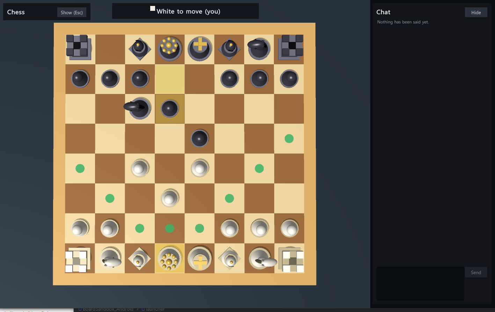
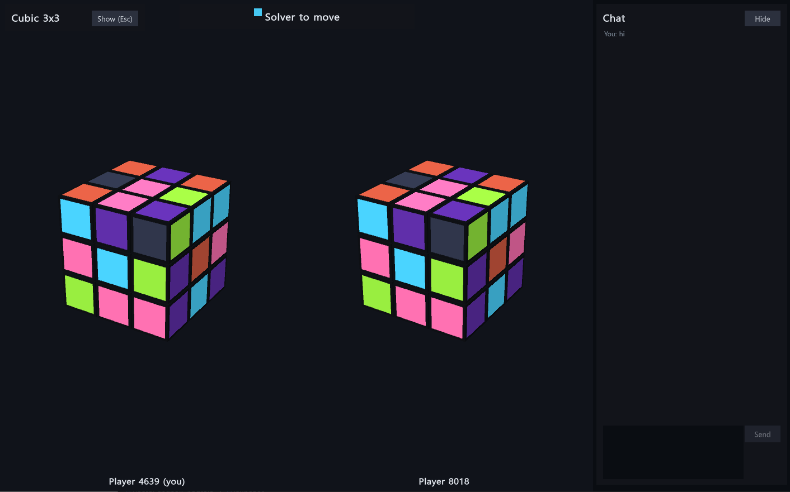
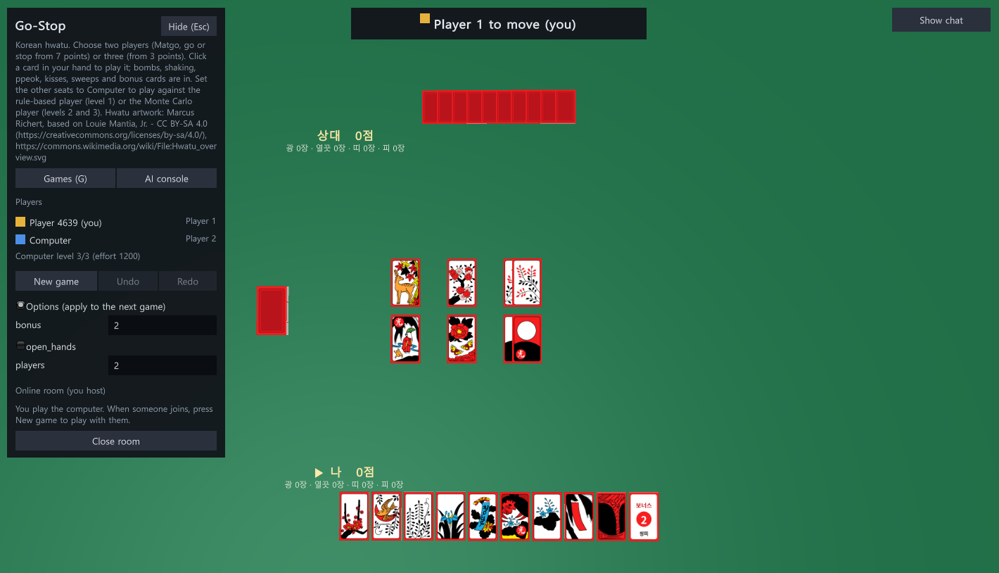
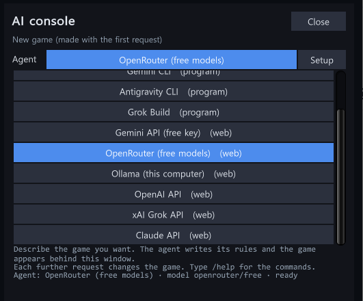

# Board Sandbox Engine

A tabletop simulator-style board game platform built on **Unity 6.3**. Game rules are written as **Luau script mods**, while Unity (C#) executes and validates the rules to visualize the results in a 3D scene.

A single folder containing a `config.json` file and `.luau` files becomes a standalone game, with zero game-specific hardcoding in the C# core engine.

* **Supported Platforms**: Windows (x64), Android (ARM64, ARMv7, x86_64)
* **Built-in Mods**: Gomoku, Chess, Sudoku (Single-player and 2-player Co-op), Go-Stop, 3D Cube Puzzle (Cubic 3x3)

---

## Core Technologies

* **Sandboxed Script Runtime**
  * Wraps a statically linked **Luau 0.745 VM** in a versioned C ABI (10 `bse_*` functions), invoked via P/Invoke with JSON input and output.
  * Strictly enforces per-call execution time limits (250ms default) and memory limits (64MB), and strips out unsafe global functions (`io`, `os`, `loadstring`, etc.).
  * Immediately recreates the VM and safely restores it to the last known good snapshot state upon script exceptions or limit violations.
* **Host-Authoritative Command Pipeline**
  * All inputs from the mouse, console, AI players, and remote participants converge into a single entry point (`GameSession.Submit`).
  * Only inputs that pass `ICommandInterceptor` (`TurnGuard`, `RejectionLog`) and the mod's `rules.command` validation are applied, with processing outcomes clearly categorized into 5 states: `Accepted`, `Rejected`, `Vetoed`, `Invalid`, and `Faulted`.
* **Event-Driven View and Presentation Playback**
  * Updates a view model mirror using events emitted by the rules engine, while `PlaybackQueue` sequentially plays back events onto a secondary view model.
  * Pauses playback during visual effect (`fx`) segments such as rotation animations, maintaining complete separation between the presentation layer and game logic.
* **Time Rewind**
  * Records state snapshots up to 4,096 steps on every move to support Undo, Redo, and arbitrary timeline scrubbing. Mods only need to implement the `snapshot`/`restore` interface to save and restore their state.
* **Deterministic Headless Simulation**
  * Runs separate VMs on background threads to execute large volumes of random matches at high speed, aggregating win rates, draw rates, average turns, and more. Identical mods, options, and seeds are guaranteed to produce 100% identical results every time.
* **Engine-Agnostic Core Architecture**
  * `BoardSandbox.Core` does not reference `UnityEngine` (`asmdef noEngineReferences`), allowing it to run identically in console applications or `.NET` test environments.
  * Abstracts mod sources into `IModSource` (`Built-in`, `Local`, `Workshop`). On Android, built-in mods are read directly from inside the APK (`ZipModSource`) while preserving the exact same content hash as when read from a standard folder.

---

## Multiplayer

* **Host-Authoritative Room Architecture and Multi-Backend Support**
  * `NetHostRoom` executes rules and broadcasts events while `NetClientRoom` plays them back, with the host validating all participant inputs.
  * Decouples the lobby and transport layers into `ILobbyBackend` and `INetTransport`, supporting both **Steam** (Windows, `STEAMWORKS_NET`) and **Epic Online Services** (Android/Windows, Device ID anonymous login and P2P).
  
  
	
* **Packet Fragmentation and Reassembly**
  * Automatically fragments room messages and reassembles them on the receiving end via the `PacketTransport` layer, even in network environments with small transmission size limits (1,170 bytes for EOS P2P).
* **Version Compatibility and Matchmaking**
  * Verifies game ID, protocol version, and mod content hashes during room matchmaking to ensure integrity.
  * Expands new features—such as AI seat filling, split-screen perspective sharing, and chat—as optional protocol fields, maintaining backward compatibility with the base protocol version (1) and older clients.
* **Diverse Play Modes and Chat**
  * **3 Screen/Play Modes**: Supports single shared screen, turn-free cooperative play, and split-screen mode where players solve their own boards while viewing their opponent's perspective in real time (with host-validated update frequencies and value ranges).
  * **Chat System**: Enforces text sanitization, anti-spam rate limiting (up to 5 lines per 5 seconds), and a retention policy keeping the most recent 100 lines.

---

## Luau-Based AI Players

To avoid affecting the ongoing game state, the current board state is restored into a **separate auxiliary VM created with the same mod**, and `rules.query("think")` is called on a background worker thread to prevent UI freezing. Commands generated by the AI pass through the exact same validation pipeline as human player inputs, and configured difficulty levels (search depth/steps) persist across app restarts.

* **Gomoku**: Applies segment-based incremental evaluation, iterative deepening alpha-beta search, and four-in-a-row threat extension search. *(Self-play benchmark: 5,000 steps vs. 50 steps — 19 wins out of 20 games)*
* **Chess**: Applies alpha-beta search combining MVV-LVA, killer/history move ordering, check extensions, quiescence search, and piece-square evaluation tables. *(Self-play benchmark: 30,000 steps vs. 6,000 steps — 8 wins out of 10 games)*
* **Go-Stop**: Uses a rule-based algorithm for Level 1, while Levels 2 and 3 perform Monte Carlo simulations (Determinization) that randomly redistribute unseen cards. *(Self-play benchmark: 1,200 steps vs. rule-based — 198 wins, 158 losses, 4 draws out of 360 games)*

---

## AI-Assisted Mod Creation

When you describe the rules of a desired board game in natural language inside the in-game AI console, the integrated AI agent automatically generates `config.json` and Luau scripts.

* **Supported Agents**: Claude Code, Codex CLI, Gemini CLI, Antigravity, Grok, local Ollama, and OpenAI-compatible API endpoints
* **Automated Validation and Self-Correction**: The engine immediately loads the generated mod and simulates up to 60 random moves; if an error occurs, the error log is fed back to the agent so it can self-correct (up to 2 retries).
* **Safety and Recovery**: You can revert to previous versions of files at any time using the `/undo` command, and user prompts are passed securely via standard input (`stdin`) or temporary files to prevent command-line argument exposure.

---

## Build and Verification

* **Native Builds and Binary Inspection**
  * Provides a CMake configuration that builds a pinned Luau commit version. Supports Windows DLLs (MSVC and Zig cross-builds) and Android `.so` (NDK) builds, complete with GitHub Actions CI workflows.
  * Uses a dedicated ELF inspection script to verify target CPU architectures, allowed dependency libraries (`libc`, `libm`, `libdl`), exported symbol lists, and **16KB page alignment** compliance.
* **Multi-Layered Test Suite**
  * Features over 480 `.NET` core harness tests that run without Unity, Unity EditMode tests, and native tests verifying the C ABI, VM lifecycle, sandbox isolation, resource limits, and multithreading stability.
  * Native libraries pass Linux ASan/UBSan memory and undefined behavior checks, and cross-built Windows DLLs are verified to run properly under Wine.
* **Android Gradle 9.1 / AGP 9.0 Compatibility Support**
  * Includes an automated build step that patches legacy library module configurations in the EOS plugin and enables Core Library Desugaring, alongside a standalone PowerShell script runnable without the Unity Editor.
* **Static Analysis and Real-Device Verification**
  * Performs static type checking on mod scripts based on `bse` type declarations via the `bse_analyze` tool.
  * Verified across core logic, networking, and CLI tool harness tests, as well as the Unity rendering pipeline, physical Android device execution, and live Steam and EOS service integrations.

### Builds
- Windows Build: [Download](https://drive.google.com/file/d/1_2vO5xoq66Gf55g6tXKK89JYEZO3Eki4/view?usp=drive_link)
- Android Build: [Download](https://drive.google.com/file/d/1SPcVkRUQnaPEPeV-nXK4K22yn-9Bdz_e/view?usp=sharing)

## License

The copyright and terms of use for Board Sandbox are located in [LICENSE.md](LICENSE.md).

Luau is third-party software outside the author's ownership and is not part of Board Sandbox. It is distributed under the MIT License (Copyright (c) 2019-2026 Roblox Corporation, 1994–2019 Lua.org, PUC-Rio) and is statically linked into `bse_luau.dll` and `libbse_luau.so`. Because the MIT License requires copyright notices and permission statements to be included in all copies, `THIRD_PARTY_NOTICES.txt` must be bundled whenever distributing the DLL, `.so`, or builds containing them (including APKs). Notices for runtime libraries included in the Zig-built DLL and NDK-built `.so` (such as LLVM libc++) are also provided in the same file.

Steamworks.NET (MIT, Riley Labrecque), used for Steam integration, and the Steamworks SDK redistributable files (`steam_api64.dll`, Valve) included in its package are also third-party software. They are not included in this repository and are fetched as packages by Unity; distributing builds requires compliance with their respective licenses and the Steamworks SDK terms.

The [EOS Plugin for Unity](https://github.com/EOS-Contrib/eos_plugin_for_unity) (MIT, Copyright (c) 2026 Epic Games Inc), used for multiplayer (Android, Windows), and the Epic Online Services SDK (Epic Games) included in its package are also third-party software. Likewise, they are not stored in this repository and are fetched as packages by Unity; distributing builds requires compliance with their respective licenses and the [Epic Online Services](https://onlineservices.epicgames.com/) terms.

The Hwatu card artwork for Go-Stop (`Assets/StreamingAssets/Mods/gostop/cards.png`) is adapted from Marcus Richert's [Hwatu overview.svg](https://commons.wikimedia.org/wiki/File:Hwatu_overview.svg) (based on Hwatu illustrations by Louie Mantia, Jr.) and is distributed under [CC BY-SA 4.0](https://creativecommons.org/licenses/by-sa/4.0/). Modifications include cropping the 48 cards into a single PNG atlas, adding a white background behind the line art, arranging the cards in Korean month order (November Paulownia, December Rain), and adding a card back along with three bonus cards (`Tools/Hwatu/make_atlas.py`). This license applies solely to `cards.png` and requires redistribution under the same terms (Attribution-ShareAlike). Identical notices appear in `Mods/gostop/ARTWORK-LICENSE.txt` and `THIRD_PARTY_NOTICES.txt`, as well as in-game within Go-Stop's description and `query credits`.
